# Medidor de energía eléctrica no invasivo de dos canales con ESP32

**Avance 2 del proyecto de aula (ABPr) — Corte 2**

Sistemas Embebidos 1 · Ingeniería Electrónica · Universidad de la Costa (CUC) · Periodo 2026-2

**Integrantes:** David Orozco · Jose Torres · Leo Rojas

---

## Contenido

1. [Introducción](#1-introducción)
2. [Objetivos](#2-objetivos)
3. [Planteamiento del problema](#3-planteamiento-del-problema)
4. [Marco teórico](#4-marco-teórico)
5. [Estado del arte](#5-estado-del-arte)
6. [Listado de materiales](#6-listado-de-materiales)
7. [Componente técnico](#7-componente-técnico)
8. [Verificación de la metodología y del cronograma](#8-verificación-de-la-metodología-y-del-cronograma)
9. [Referencias](#9-referencias)
10. [Anexo: archivos fuente y cómo regenerar las ilustraciones](#10-anexo-archivos-fuente-y-cómo-regenerar-las-ilustraciones)

---

## 1. Introducción

Cuando una vivienda o un local comercial no cuenta con medición adicional, la factura informa el
consumo mensual total con hasta treinta días de retraso. Ese dato no permite identificar el consumo
por carga ni por hora, y dificulta evaluar las medidas de ahorro. En la región Caribe, el uso del aire
acondicionado durante el año representa una parte importante del consumo [1].

Este proyecto tiene como objetivo desarrollar un medidor de energía monofásico de 120 V / 60 Hz basado en el microcontrolador
**ESP32**. La medida es **no invasiva**: la corriente se obtiene con pinzas de núcleo partido
**SCT-013-000** que abrazan el conductor de fase sin abrir el circuito, y la tensión con un módulo
**ZMPT101B** que la reduce mediante un transformador aislado. El sistema tiene **dos canales de
corriente** —CH1 para el total del tablero y CH2 para un subcircuito, por ejemplo el del aire
acondicionado— y **un canal de tensión**. El ESP32 digitaliza las tres señales con su convertidor
interno, calcula tensión y corriente eficaces, potencia activa, reactiva y aparente y factor de
potencia, y publica los resultados por Wi-Fi.

Este documento corresponde al segundo avance. Presenta el diseño eléctrico en KiCad, los cálculos de
los componentes, el diseño y los archivos de fabricación de la PCB de una cara, el diseño del gabinete,
el protocolo de pruebas y el estado del cronograma. El montaje del prototipo está pendiente. El
*firmware* y la plataforma se han probado con señales sintéticas y datos simulados; falta validarlos
con el equipo físico en el tercer corte.

## 2. Objetivos

### 2.1. Objetivo general

Desarrollar un medidor de energía eléctrica monofásico y no invasivo, basado en ESP32, con dos canales
de corriente y un canal de tensión aislado, montado en una PCB de una cara dentro de un gabinete con la
zona de red separada, que calcule tensión y corriente eficaces, potencias activa, reactiva y aparente y
factor de potencia por canal, y los publique por Wi-Fi.

### 2.2. Objetivos específicos

1. **Diseñar** la cadena de acondicionamiento (resistencia de carga, polarización, filtro antialias y
   protección) y el esquemático completo en KiCad, sin errores en la verificación eléctrica (ERC), de
   modo que 60 A en CH1 y 30 A en CH2 queden dentro de la zona lineal del ADC1 del ESP32.
2. **Construir** el prototipo en una PCB de una cara fabricada por el grupo, integrado con el microcontrolador dentro del
   gabinete, y aprobar la verificación previa a la energización y la prueba de resistencia
   (*HardExplosion*).
3. **Programar y validar** el *firmware* de adquisición y cálculo (8.000 muestras por segundo por canal,
   ventanas de ciclos completos) y el envío de los registros a la plataforma web, con un error de potencia activa de ±3 % o
   menos frente a una carga resistiva de potencia conocida entre 1 A y 30 A.

## 3. Planteamiento del problema

El Sistema Interconectado Nacional sigue aumentando su demanda año tras año, y la región Caribe consume
una fracción de la energía nacional mayor que su fracción de la población; en los edificios
comerciales de la región el aire acondicionado representa en promedio cerca de la mitad del consumo
total [1]. La factura residencial o comercial presenta el consumo mensual registrado por el contador, sin
desglosarlo por circuito o equipo.

Esa lectura tiene tres limitaciones:

- **Resolución temporal de un mes.** No muestra los ciclos diario y semanal, que son los que dominan en
  un clima sin estaciones.
- **Agregación total.** No distingue qué circuito o qué equipo produjo el consumo, de modo que la factura
  no puede atribuirse a cargas concretas.
- **Latencia.** El usuario conoce su consumo hasta treinta días después, y una acción de ahorro no se
  puede verificar antes del siguiente ciclo de facturación.

Algunos medidores comerciales con Wi-Fi permiten consultar el consumo, pero tienen una arquitectura
cerrada y no dan acceso a la forma de onda ni al método de cálculo. Esto limita su uso para estudiar
la cadena de medición en el curso de sistemas embebidos, desde el sensor y el acondicionamiento hasta
la conversión analógica-digital, el procesamiento y la comunicación.

**Pregunta del proyecto:** ¿cómo medir, con un microcontrolador de bajo costo y sin intervenir la
instalación, el consumo de una edificación por circuito y en tiempo casi real, de forma segura para el
usuario y con un error conocido?

> **Alineación con el primer entregable.** El primer entregable definió un nodo ESP32 con tres pinzas y
> un canal de tensión. Para el alcance de esta asignatura se implementan **dos canales de corriente**
> (total y un subcircuito) y el tercero queda como reserva cableada en el conector J7, que expone las
> entradas GPIO34, GPIO32 y GPIO33 del ADC1 (sección 7.3). El problema, la arquitectura y los criterios
> de seguridad no cambian.

## 4. Marco teórico

### 4.1. Magnitudes eléctricas en régimen periódico

Para una tensión $v(t)$ y una corriente $i(t)$ periódicas de periodo $T$ (16,67 ms a 60 Hz), los valores
eficaces y la potencia activa se definen como [6]:

$$V_{rms} = \sqrt{\frac{1}{T}\int_0^T v^2(t)\,dt}, \qquad I_{rms} = \sqrt{\frac{1}{T}\int_0^T i^2(t)\,dt}, \qquad P = \frac{1}{T}\int_0^T v(t)\,i(t)\,dt$$

La potencia aparente es $S = V_{rms} I_{rms}$, el factor de potencia es $FP = P/S$ y, en régimen
sinusoidal, la potencia reactiva es $Q = \sqrt{S^2 - P^2}$. Con muestras discretas tomadas a la
frecuencia $f_s$, las integrales se reemplazan por sumas sobre un número **entero** de ciclos, lo que
evita el error de truncamiento de la ventana:

$$V_{rms} \approx \sqrt{\frac{1}{N}\sum_{n=0}^{N-1} v_n^2}, \qquad P \approx \frac{1}{N}\sum_{n=0}^{N-1} v_n\, i_n$$

La norma IEEE 1459 [6] extiende estas definiciones a señales no sinusoidales, en las que aparecen
armónicos; es el caso de las fuentes conmutadas y de los equipos con variador de frecuencia.

### 4.2. Transformador de corriente de núcleo partido

Un transformador de corriente (TC) entrega en su secundario una corriente proporcional a la del
primario, en la relación inversa del número de espiras. El SCT-013-000 tiene relación 100 A : 50 mA, es
decir $N = 2000$ espiras, y **no incluye resistencia de carga interna** [2]. El conductor de fase que
atraviesa el núcleo actúa como primario de una sola espira:

$$I_s = \frac{I_p}{N}$$

Para convertir esa corriente en tensión se conecta una resistencia de carga (en inglés, *burden*)
$R_b$ entre los terminales del secundario: $V_b = I_s R_b$.

**Riesgo del secundario abierto.** Si el secundario queda abierto mientras el primario conduce, toda la
fuerza magnetomotriz del primario magnetiza el núcleo, este se satura y en los terminales aparecen
picos de tensión peligrosos para las personas y para el ADC. Por eso la resistencia de carga va soldada
directamente en el conector y nunca en un cable que se pueda desconectar [10].

### 4.3. Medición aislada de la tensión

El ZMPT101B es un transformador de tensión de pequeña señal, con relación 1000:1000 y aislamiento
galvánico entre primario y secundario [3]. El módulo comercial agrega en serie con el primario una
resistencia que limita la corriente, y en el secundario un amplificador LM358 con un potenciómetro de
ganancia. La salida es una sinusoide montada sobre la mitad de la tensión de alimentación, 2,5 V si el
módulo se alimenta con 5 V. Es la **única** pieza del sistema conectada galvánicamente a la red; todo
lo demás opera en muy baja tensión.

### 4.4. Muestreo, aliasing y filtro antialias

El teorema de muestreo [9] exige $f_s > 2 f_{max}$ para reconstruir una señal sin ambigüedad. Si se
quieren observar armónicos hasta el orden 50 (3.000 Hz), se necesita $f_s > 6.000$ muestras/s. El
proyecto usa **8.000 muestras/s por canal**, es decir 133 muestras por ciclo de 60 Hz. Las componentes
por encima de $f_s/2$ se "pliegan" dentro de la banda útil. Para evitarlo, cada canal tiene un filtro RC
pasa-bajas de primer orden:

$$f_c = \frac{1}{2\pi R C}$$

Como la potencia activa depende del producto $v \cdot i$, un desfase $\Delta\varphi$ entre los filtros de
tensión y de corriente produce un error relativo en $P$ cercano a $\tan\varphi \cdot \Delta\varphi$. Por eso
los tres filtros deben tener constantes de tiempo casi iguales.

### 4.5. ADC del ESP32

El ESP32 tiene dos convertidores SAR de 12 bits. El **ADC2 no se puede usar mientras el Wi-Fi está
activo**, porque el controlador de radio lo ocupa [5]; en consecuencia, todas las entradas analógicas de
este proyecto están en el **ADC1** (GPIO32 a GPIO39). Con atenuación de 11 dB el rango útil y lineal
va de unos 0,15 V a 2,45 V [5]. Fuera de ese rango la curva de conversión se vuelve no lineal. Las
señales bipolares de la red se desplazan entonces a un nivel de reposo positivo (polarización) para que
la excursión completa caiga dentro de esa ventana.

### 4.6. Seguridad eléctrica

El Reglamento Técnico de Instalaciones Eléctricas (RETIE) [8] establece la separación entre circuitos de
red y de muy baja tensión (MBT), la protección contra sobrecorriente y el código de colores de los
conductores. El diseño del prototipo contempla cuatro criterios:

1. La red de 120 V nunca entra a la PCB: llega solo al módulo ZMPT101B, ubicado en un
   compartimento separado del gabinete por un tabique.
2. La rama de tensión está protegida con un fusible lento de 500 mA.
3. Las pinzas abrazan únicamente el conductor de fase y no se abre ningún circuito para instalarlas.
4. No se energiza el equipo sin una verificación de aislamiento firmada por dos integrantes
   (sección 7.9).

## 5. Estado del arte

La **Tabla 1** resume soluciones comerciales y abiertas para medir consumo eléctrico, comparadas en las
características que interesan a este proyecto.

**Tabla 1.** Comparación de medidores de energía existentes.

| Solución | Medición | Canales | Procesamiento y comunicación | Acceso a la forma de onda | Observación |
|---|---|---|---|---|---|
| Shelly EM [11] | Pinzas de corriente y tensión directa | 2 | Integrado; Wi-Fi | No | Comercial, muy cercana en alcance a este proyecto |
| Emporia Vue [12] | 2 TC principales y hasta 16 TC por circuito | Hasta 18 | Integrado; Wi-Fi y nube propia | No | Cerrado, orientado al consumidor |
| Sense [13] | 2 TC de 200 A | 2 | Muestreo de alta frecuencia y desagregación de cargas | No para el usuario | Identifica equipos por su firma eléctrica (NILM) [7] |
| IoTaWatt [14] | TC y transformador de tensión externo | 14 | ESP8266 con ADC externo; Wi-Fi | Parcial | *Hardware* y *software* abiertos |
| OpenEnergyMonitor emonTx [10] | TC SCT-013 y adaptador de CA | 3 a 6 | Microcontrolador AVR; radio | Sí | Referencia de diseño del acondicionamiento con resistencia de carga y divisor de polarización |
| PZEM-004T v3.0 [15] | TC propio y conexión directa a red | 1 | Integrado; Modbus-RTU | No | Módulo económico, entrega valores ya calculados una vez por segundo |
| Integrado de metrología ATM90E32AS [16] | Requiere acondicionamiento externo | 3 fases | ADC sigma-delta simultáneos; SPI | No (registros) | Exactitud de contador; procesamiento interno no accesible; requiere importación |
| **Este proyecto** | **2 SCT-013-000 + ZMPT101B** | **2 + 1 tensión** | **ESP32, ADC1 interno; Wi-Fi y HTTP** | **Sí, 8.000 muestras/s por canal** | **Arquitectura abierta; cálculo implementado por el grupo** |

Fuente: elaboración propia a partir de la documentación de cada producto.

Del análisis se concluye que:

- Las soluciones comerciales sin acceso a las muestras ni al método de cálculo limitan el estudio
  de la cadena de adquisición, que forma parte del objetivo académico de la asignatura.
- Los proyectos abiertos (OpenEnergyMonitor, IoTaWatt) validan el enfoque de **pinza SCT-013 +
  resistencia de carga + divisor de polarización + ADC del microcontrolador**, que es el adoptado aquí.
- El acceso a las muestras sin procesar permitiría aplicar técnicas de desagregación de cargas
  (NILM) [7], que los módulos cerrados como el PZEM-004T no permiten.

## 6. Listado de materiales

La **Tabla 2** lista todos los materiales del prototipo. Las referencias de componente coinciden con el
esquemático de la Ilustración 2.

**Tabla 2.** Lista de materiales.

| # | Referencia | Descripción | Cant. | Uso |
|---:|---|---|---:|---|
| 1 | U1 | Tarjeta ESP32-DevKitC V4, 38 pines (ESP32-WROOM-32) | 1 | Microcontrolador, ADC y Wi-Fi |
| 2 | — | Pinza de corriente YHDC SCT-013-000, 100 A : 50 mA, sin resistencia de carga | 2 | Medición de corriente CH1 y CH2 |
| 3 | U2 | Módulo sensor de tensión ZMPT101B (con LM358 y potenciómetro) | 1 | Medición aislada de tensión |
| 4 | J6 | Pantalla OLED SSD1306 de 0,96", 128 × 64, I2C | 1 | Lectura local |
| 5 | — | Baquelita de una cara de 10 × 15 cm (FR-2 o FR-4), percloruro férrico, papel de transferencia y alambre UTP para los puentes | 1 | PCB del circuito (sección 7.7) |
| 6 | — | Adaptador 100–240 V CA a 5,1 V CC (5,0–5,25 V), 2 A o más, con aislamiento certificado | 1 | Alimentación |
| 7 | — | *Jack* de panel para alimentación de 5,5 × 2,1 mm | 1 | Entrada de 5 V en el gabinete |
| 8 | J2, J3 | *Jack* estéreo hembra de 3,5 mm para panel | 2 | Conexión de las pinzas |
| 9 | J1 | Bornera de 2 polos, paso 5,08 mm | 1 | Entrada de 5 V en la placa |
| 10 | J5 | Bornera de 3 polos, paso 5,08 mm | 1 | Cable del módulo ZMPT101B |
| 11 | J4 | Regleta de 2 bornes de tornillo | 1 | Empalme de fase y neutro en la zona de red |
| 12 | F1 | Portafusible de 5 × 20 mm y fusible lento T 500 mA, 250 V | 1 + 1 de repuesto | Protección de la rama de tensión |
| 13 | F2 | Fusible PTC de rearme automático MF-R110 (1,1 A de mantenimiento) | 1 | Protección contra cortocircuito en 5 V |
| 14 | D1 | Diodo Schottky 1N5819 | 1 | Protección contra polaridad invertida |
| 15 | D2–D7 | Diodo Schottky BAT85 (DO-35) | 6 | Recorte de sobretensión en las entradas del ADC |
| 16 | R1 | Resistencia 22 Ω, 1 %, película metálica, 1/4 W | 1 | Resistencia de carga CH1 |
| 17 | R2 | Resistencia 47 Ω, 1 %, película metálica, 1/4 W | 1 | Resistencia de carga CH2 |
| 18 | R5, R6 | Resistencia 3,3 kΩ, 1 % | 2 | Filtro antialias de corriente |
| 19 | R3 | Resistencia 15 kΩ, 1 % | 1 | Divisor de polarización |
| 20 | R4, R12, R13 | Resistencia 10 kΩ, 1 % | 3 | Polarización y *pull-up* de pulsadores |
| 21 | R7, R8 | Resistencia 11 kΩ y 13 kΩ, 1 % (serie E24) | 1 + 1 | Divisor de tensión |
| 22 | R9, R10 | Resistencia 4,7 kΩ | 2 | *Pull-up* del bus I2C |
| 23 | R11 | Resistencia 330 Ω | 1 | Limitación de corriente del LED |
| 24 | C1 | Condensador electrolítico 470 µF, 10 V | 1 | Reserva de energía en 5 V |
| 25 | C7 | Condensador electrolítico 10 µF, 16 V | 1 | Filtrado de VBIAS |
| 26 | C5, C6 | Condensador 47 nF, dieléctrico C0G (alternativa: película MKT 5 %) | 2 | Filtro antialias de corriente |
| 27 | C9 | Condensador 27 nF, dieléctrico C0G (alternativa: película MKT 5 %) | 1 | Filtro antialias de tensión |
| 28 | C2, C8, C10, C11 | Condensador cerámico 100 nF, X7R | 4 | Desacoplamiento y filtro contra rebotes |
| 29 | D8 | LED verde de 5 mm con soporte de panel | 1 | Indicador de estado |
| 30 | SW1, SW2 | Pulsador de panel de 12 mm, normalmente abierto | 2 | Interfaz de usuario |
| 31 | — | Espadín hembra 1 × 19 | 2 | Zócalo del ESP32 |
| 32 | J6, J7 | Espadín hembra 1 × 4 | 2 | Pantalla y reserva |
| 33 | — | Espadín macho 1 × 2 | 3 | Cables del LED y los pulsadores |
| 34 | — | Gabinete de 200 × 150 × 75 mm en ABS (impreso en FDM o caja comercial) con tabique de 3 mm | 1 | Estructura del sistema |
| 35 | — | Prensaestopas PG7 | 1 | Entrada del cable de red con alivio de tracción |
| 36 | — | Separadores M3 de 10 mm con tornillos | 8 | Fijación de la placa y del módulo ZMPT101B |
| 37 | — | Cable 22 AWG en rojo, naranja, negro, violeta, amarillo, verde, azul, blanco y gris | 1 juego | Puentes y cableado de MBT |
| 38 | — | Cable 18 AWG en negro, blanco y verde | 1 m | Cableado de la zona de red |
| 39 | — | Alambre estañado 22 AWG, tubo termoencogible y estaño | — | Pistas de la cara de soldadura |

Fuente: elaboración propia.

## 7. Componente técnico

### 7.1. Arquitectura del sistema

El sistema se divide en cinco bloques: medición, acondicionamiento, adquisición, interfaz local y
comunicación (Ilustración 1). La frontera de seguridad separa la **zona de red** (rojo), que contiene
únicamente el fusible y el módulo ZMPT101B, de la **zona de muy baja tensión** (azul), donde está todo
lo que se suelda en la PCB.

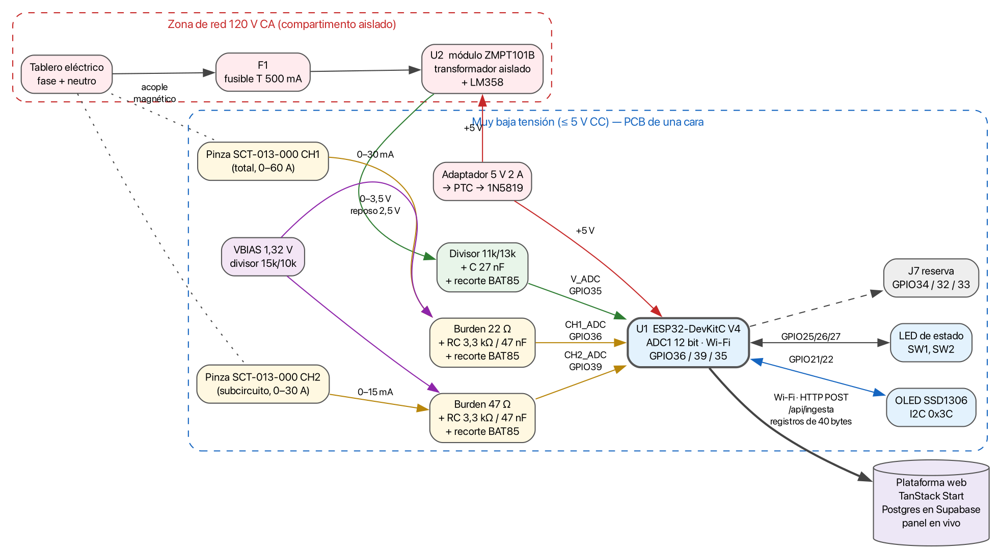

**Ilustración 1.** Diagrama de bloques del medidor. Las flechas punteadas indican acople magnético (las
pinzas no tienen contacto eléctrico con la red). Fuente: elaboración propia en Graphviz.

### 7.2. Esquemático

El esquemático completo se diseñó en **KiCad 10** (archivo
[`hardware/medidor-energia.kicad_sch`](hardware/medidor-energia.kicad_sch), versión en PDF en
[`hardware/medidor-energia.pdf`](hardware/medidor-energia.pdf)). La verificación eléctrica (ERC) termina
con **0 errores y 0 advertencias** ([`hardware/erc.rpt`](hardware/erc.rpt)). Las conexiones entre bloques
usan etiquetas de red con el mismo nombre: `CH1_ADC`, `CH2_ADC`, `V_ADC`, `VBIAS`, `ZMPT_OUT`, `I2C_SCL`,
`I2C_SDA`, `LED_EST`, `SW1`, `SW2` y `RES_IO32/33/34`.

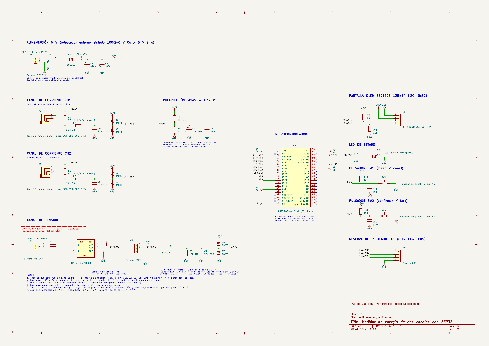

**Ilustración 2.** Esquemático del medidor (hoja A3). El recuadro rojo punteado delimita la zona de red.
Fuente: elaboración propia en KiCad 10.

### 7.3. Asignación de pines del ESP32

**Tabla 3.** Pines utilizados del ESP32-DevKitC V4.

| Pin de la tarjeta | GPIO | Red | Función | Justificación |
|---:|---|---|---|---|
| 3 | GPIO36 (VP) | `CH1_ADC` | ADC1 canal 0: corriente CH1 | Solo entrada, ADC1 (funciona con Wi-Fi activo) |
| 4 | GPIO39 (VN) | `CH2_ADC` | ADC1 canal 3: corriente CH2 | Solo entrada, ADC1 |
| 6 | GPIO35 | `V_ADC` | ADC1 canal 7: tensión | Solo entrada, ADC1 |
| 5, 7, 8 | GPIO34, 32, 33 | `RES_IO34/32/33` | Reserva (CH3 a CH5) en J7 | Tres entradas del ADC1 reservadas para ampliar los canales del nodo |
| 9 | GPIO25 | `LED_EST` | LED de estado | Pin de ADC2 usado solo como salida digital |
| 10, 11 | GPIO26, 27 | `SW1`, `SW2` | Pulsadores | Pines de ADC2 usados solo como entradas digitales |
| 25 | GPIO21 | `I2C_SDA` | Datos de la pantalla OLED | Pin I2C por defecto en el entorno de desarrollo |
| 22 | GPIO22 | `I2C_SCL` | Reloj de la pantalla OLED | Pin I2C por defecto |
| 1 | 3V3 | `+3V3` | Salida del regulador de la tarjeta | Alimenta polarización, diodos de recorte, OLED y *pull-up* |
| 19 | 5V | `+5V` | Entrada de alimentación | Viene del adaptador a través de F2 y D1 |
| 14, 20, 26 | GND | `GND` | Tierra | El pin 14 recibe solo el GND analógico (sección 7.4.6) |

Fuente: elaboración propia con base en la hoja de datos del ESP32 [4].

No se usan los pines GPIO6 a GPIO11, conectados a la memoria flash interna, ni los pines de arranque
GPIO0, GPIO2, GPIO5, GPIO12 y GPIO15, cuyo nivel al encender define el modo de inicio [4]. En el
esquemático todos los pines no usados llevan la marca de "sin conexión".

### 7.4. Cálculos de diseño

#### 7.4.1. Resistencia de carga de los canales de corriente

El nivel de reposo es $V_{BIAS} = 1{,}32$ V (sección 7.4.2). Para que la señal quede dentro de la zona
lineal del ADC (0,15 V a 2,45 V) con margen, el pico admisible sobre el reposo se fija en 1,0 V. Esto
deja 1,13 V hacia arriba antes de la zona no lineal.

**CH1 (total del tablero, 60 A eficaces):**

$$I_{s,pk} = \frac{60\sqrt{2}}{2000} = 42{,}43\ \text{mA} \;\Rightarrow\; R_b \le \frac{1{,}0\ \text{V}}{42{,}43\ \text{mA}} = 23{,}6\ \Omega \;\rightarrow\; R_1 = 22\ \Omega$$

Con 22 Ω el pico es 0,933 V y la señal oscila entre 0,39 V y 2,25 V. La señal llega al límite lineal de
2,45 V con $I_p = 1{,}13 / 22 \cdot 2000 / \sqrt{2} = 72{,}6$ A eficaces (21 % de margen). La potencia
disipada en la resistencia es $(30\ \text{mA})^2 \cdot 22\ \Omega = 19{,}8$ mW, muy por debajo de 1/4 W.

**CH2 (subcircuito, 30 A eficaces):**

$$I_{s,pk} = \frac{30\sqrt{2}}{2000} = 21{,}21\ \text{mA} \;\Rightarrow\; R_b \le 47{,}1\ \Omega \;\rightarrow\; R_2 = 47\ \Omega$$

El pico es 0,997 V y la señal oscila entre 0,32 V y 2,32 V; el límite lineal se alcanza con 34,0 A
(13 % de margen). Disipa 10,6 mW.

**Sensibilidad.** CH1 produce 11 mV eficaces por amperio y CH2, 23,5 mV/A. Con un paso de conversión
cercano a 0,8 mV, un código del ADC equivale a unos 73 mA en CH1 y 34 mA en CH2. El promedio sobre
ventanas de miles de muestras reduce el ruido por debajo de ese valor.

> **Cambio frente al primer entregable.** El primer diseño usaba 27 Ω y 51 Ω con un pico de 1,15 V
> centrado en 1,65 V, lo que lleva la señal hasta 2,80 V, fuera de la zona lineal del ADC con atenuación
> de 11 dB [5]. Bajar el reposo a 1,32 V y las resistencias a 22 Ω y 47 Ω (valores comerciales de la serie
> E12) corrige ese problema. Las resistencias de 0,1 % especificadas antes no se consiguen en el comercio
> local; se usan de 1 % y la diferencia se absorbe en la constante de calibración de cada canal.

#### 7.4.2. Polarización (VBIAS)

$$V_{BIAS} = 3{,}3\ \text{V} \cdot \frac{R_4}{R_3 + R_4} = 3{,}3 \cdot \frac{10\ \text{k}\Omega}{25\ \text{k}\Omega} = 1{,}32\ \text{V}$$

- Resistencia equivalente del divisor: $R_{Th} = 15 \parallel 10 = 6$ kΩ.
- C7 = 10 µF forma con $R_{Th}$ un filtro de $f_c = 1/(2\pi \cdot 6\ \text{k}\Omega \cdot 10\ \mu\text{F}) = 2{,}65$ Hz, que
  atenúa 27 dB el rizado de 60 Hz que pueda venir por la línea de 3,3 V. C8 = 100 nF filtra las
  frecuencias altas, donde el electrolítico pierde eficacia.
- Tiempo de establecimiento: $5\tau = 5 \cdot 60\ \text{ms} = 0{,}3$ s. El *firmware* descarta los primeros
  500 ms después del encendido.
- Consumo del divisor: $3{,}3\ \text{V} / 25\ \text{k}\Omega = 132\ \mu$A.

Un solo divisor sirve a los dos canales: la corriente de cada pinza circula únicamente por su
resistencia de carga, y el nodo VBIAS solo entrega la pequeña corriente de muestreo del ADC.

#### 7.4.3. Filtro antialias y protección de las entradas

- **Canales de corriente:** R5 = R6 = 3,3 kΩ y C5 = C6 = 47 nF.
  $f_c = 1/(2\pi \cdot 3{,}3\ \text{k}\Omega \cdot 47\ \text{nF}) = 1{,}03$ kHz, que deja pasar los armónicos de interés
  y atenúa lo que se plegaría desde los 8 kHz de muestreo. Contando la resistencia de carga en serie,
  las constantes de tiempo son τ = 156 µs (CH1) y 157 µs (CH2).
- **El condensador como depósito de carga.** El condensador de muestreo del ADC es del orden de
  picofaradios. Frente a 47 nF, la carga que toma en cada conversión cambia la tensión del nodo en una
  fracción despreciable, menor que un código del ADC. Por eso no hace falta el amplificador separador
  (MCP6004) del primer diseño, que además no se consigue en el país.
- **Recorte:** D2/D3, D4/D5 y D6/D7 (BAT85) conducen si el nodo supera 3,3 V + 0,3 V o baja de −0,3 V,
  y la resistencia en serie limita la corriente. Si por una falla llegaran 5 V al nodo, la corriente
  sería $(5 - 3{,}6)/3{,}3\ \text{k}\Omega \approx 0{,}42$ mA, tolerable para el diodo y para el pin.
  > **Cambio por la simulación (sección 7.12).** El primer cálculo usaba 1,5 kΩ y 100 nF. La simulación
  > mostró que con esa resistencia el pin pasaba el máximo absoluto de 3,6 V (hasta 3,615 V) con
  > sobrecorrientes de 80 A en CH2 o 200 A en CH1. Con 3,3 kΩ la corriente por los diodos baja a menos de
  > la mitad, su caída también baja y el pin queda dentro del límite. La constante de tiempo se conserva.

#### 7.4.4. Canal de tensión

El módulo ZMPT101B, alimentado con 5 V, entrega una sinusoide montada sobre 2,5 V. Su LM358 no llega
al riel superior y solo puede subir hasta unos 3,5 V, así que el pico útil a la salida del módulo es de
1,0 V.

- **Ajuste del potenciómetro:** 0,65 V pico a la salida del módulo con 120 V eficaces de red. Así queda
  margen hasta unos 185 V eficaces antes de que el LM358 recorte.
- **Divisor R7–R8:** lleva el reposo a $2{,}5 \cdot 13/(11 + 13) = 1{,}35$ V y escala la señal por 0,542.
  En operación nominal el pin GPIO35 ve 1,35 V ± 0,35 V. Aun en el peor caso (salida del módulo en
  3,5 V), el pin recibe 1,90 V, dentro de la zona lineal.
- **Filtro:** la resistencia equivalente es $R_7 \parallel R_8 = 5{,}96$ kΩ; con C9 = 27 nF,
  τ = 161 µs y $f_c = 0{,}99$ kHz. Los valores de R7 y R8 (serie E24) se eligieron para que τ quede junto
  a los 156 y 157 µs de los canales de corriente: el desfase a 60 Hz es de 3,47° en tensión, frente a
  3,37° en CH1 y 3,40° en CH2. La diferencia máxima (0,10°) produce un error en $P$ de 0,06 % con
  FP = 0,95 y se compensa en el *firmware* junto con el desfase propio del transformador.

#### 7.4.5. Alimentación

- **Presupuesto de corriente:** ESP32 con Wi-Fi, 120 mA promedio con picos de hasta 500 mA durante la
  transmisión; módulo ZMPT101B, unos 5 mA; pantalla OLED, unos 20 mA; LED, 3,6 mA. El pico total queda
  por debajo de 550 mA, por lo que un adaptador de 2 A supera la corriente máxima prevista.
- **F2 (PTC MF-R110):** conduce 1,1 A de forma continua y se abre por encima de unos 2,2 A. Protege el
  adaptador y el cableado ante un cortocircuito y se rearma solo cuando se retira la falla.
- **D1 (1N5819):** si el adaptador se conecta con la polaridad invertida, el diodo bloquea la corriente.
  También impide que, al conectar el USB para programar, el DevKitC alimente al adaptador en sentido
  inverso. La simulación (sección 7.12) da 4,56 V en el pin de 5 V con un adaptador de 5,0 V y 500 mA,
  suficiente para el regulador AMS1117 de la tarjeta, que necesita 3,3 V + 1,1 V = 4,4 V. Con un
  adaptador en el mínimo de la norma USB (4,75 V) quedan 4,31 V y el riel de 3,3 V baja a unos 3,2 V
  durante las ráfagas: el ESP32 sigue funcionando (mínimo 3,0 V), pero por eso se especifica un
  adaptador de 5,1 V.
- **C1 (470 µF) y C2 (100 nF):** el primero sostiene la tensión durante las ráfagas de transmisión
  Wi-Fi y el segundo filtra las frecuencias altas.

#### 7.4.6. Tierra en estrella

La tierra analógica (canales, polarización y módulo ZMPT101B) se une al DevKitC **solo en el pin 14**.
La corriente de alimentación y la de la parte digital (pantalla, LED y pulsadores) retornan por los
pines 20 y 26. Así las corrientes del radio Wi-Fi no circulan por la tierra de referencia de las
señales analógicas. Los tres pines GND se unen dentro del módulo, en su plano de tierra.

#### 7.4.7. Interfaz local

- **LED:** $I = (3{,}3 - 2{,}1)\ \text{V} / 330\ \Omega = 3{,}6$ mA, muy por debajo de los 40 mA máximos del pin.
- **Pulsadores:** resistencia de *pull-up* de 10 kΩ y condensador de 100 nF a tierra, que forman un
  filtro contra rebotes de τ = 1 ms. El *firmware* añade un filtro de 20 ms por *software*.
- **I2C:** las resistencias de *pull-up* de 4,7 kΩ aseguran un tiempo de subida de unos 0,4 µs con
  100 pF de capacitancia de bus, compatible con el modo estándar de 100 kHz.

### 7.5. Justificación de cada componente

**Tabla 4.** Función de cada componente y qué fallaría sin él.

| Referencia | Valor | Función | Si se omite o se cambia |
|---|---|---|---|
| R1 | 22 Ω 1 % | Convierte la corriente del TC de CH1 en tensión | Sin ella, el secundario queda abierto: picos peligrosos. Con un valor mayor, la señal recorta antes de 60 A |
| R2 | 47 Ω 1 % | Ídem para CH2 (30 A) | Ídem |
| R3, R4 | 15 kΩ / 10 kΩ | Fijan VBIAS = 1,32 V | La señal bipolar tendría semiciclos negativos que el ADC no puede leer |
| C7, C8 | 10 µF / 100 nF | Estabilizan VBIAS | El ruido de 3,3 V aparecería como corriente falsa |
| R5, R6 + C5, C6 | 3,3 kΩ + 47 nF | Filtro antialias y depósito de carga del ADC | Armónicos plegados y error por la carga que toma el muestreo |
| D2–D7 | BAT85 | Recortan las sobretensiones en las entradas del ADC | Una pinza mal conectada o un transitorio puede dañar el ESP32 |
| R7, R8 | 11 kΩ / 13 kΩ | Llevan la salida del ZMPT101B al rango del ADC | El reposo de 2,5 V y los picos de 3,5 V saldrían de la zona lineal |
| C9 | 27 nF | Antialias del canal de tensión, con τ similar al de corriente | Desfase entre tensión y corriente: error en P y en Q |
| F1 | T 500 mA | Corta una falla en la rama de red | Un cortocircuito en el módulo quedaría protegido solo por el interruptor del tablero |
| F2 | PTC 1,1 A | Protege la entrada de 5 V | Un cortocircuito podría quemar pistas o el adaptador |
| D1 | 1N5819 | Bloquea la polaridad invertida y la realimentación desde el USB | Un adaptador invertido destruiría la tarjeta |
| C1, C2 | 470 µF / 100 nF | Reserva y desacoplamiento de 5 V | Reinicios del ESP32 durante las ráfagas Wi-Fi |
| R9, R10 | 4,7 kΩ | Resistencias de *pull-up* del I2C | El bus queda flotante si el módulo OLED no las trae |
| R11 | 330 Ω | Limita la corriente del LED | Sobrecorriente en el LED y en el pin |
| R12, R13 + C10, C11 | 10 kΩ + 100 nF | Nivel alto en reposo y filtro contra rebotes | Lecturas falsas por rebote mecánico |
| J7 | Espadín 1 × 4 | Expone las tres entradas restantes del ADC1 | Agregar un canal obligaría a modificar la placa |

Fuente: elaboración propia.

### 7.6. Código de colores del cableado

Cada cable y cada pista se identifica por su función. El mismo código se usa en las Ilustraciones 4 y 5.

**Tabla 5.** Código de colores.

| Color | Uso | Calibre |
|---|---|---|
| Rojo | +5 V (adaptador, pin 5V del DevKitC, alimentación del ZMPT101B) | 22 AWG |
| Naranja | +3,3 V | 22 AWG |
| Negro | GND de muy baja tensión | 22 AWG |
| Violeta | VBIAS (1,32 V) | 22 AWG |
| Amarillo | Señales de corriente CH1 y CH2 (*jack* hacia la placa y salidas al ADC) | 22 AWG, par trenzado desde cada *jack* |
| Verde | Señal de tensión (`ZMPT_OUT`, `V_ADC`) | 22 AWG |
| Azul | Bus I2C (SDA, SCL) | 22 AWG |
| Blanco | LED y pulsadores | 22 AWG |
| Gris | Reserva del ADC1 (J7) | 22 AWG |
| **Negro** | **Fase de la red, solo dentro del compartimento de red** | **18 AWG** |
| **Blanco** | **Neutro de la red, solo dentro del compartimento de red** | **18 AWG** |
| **Verde** | **Tierra de protección (si el cable de red la trae; el gabinete plástico no la necesita)** | **18 AWG** |

Fuente: elaboración propia; colores de red según el RETIE [8].

Los colores de red coinciden con algunos de MBT (negro, blanco y verde). Para distinguirlos, el diseño
usa conductores de red de otro calibre y los ubica en el compartimento separado por el tabique.

### 7.7. Placa de circuito impreso (PCB) de una cara

#### 7.7.1. Diseño y fabricación

El circuito se montará en una PCB de **una sola cara** diseñada en KiCad 10
([`hardware/medidor-energia.kicad_pcb`](hardware/medidor-energia.kicad_pcb)), pensada para
fabricarse en el laboratorio por transferencia de tóner o por fresado CNC sobre una baquelita de
10 × 15 cm. La placa la genera el script [`herramientas/generar_pcb.py`](herramientas/generar_pcb.py)
a partir de la netlist del esquemático, con la interfaz de Python de KiCad (`pcbnew`):

- **Contorno:** 150 × 90 mm y 1,6 mm de espesor, con cuatro agujeros M3 a 4 mm de las esquinas, que
  coinciden con los separadores del gabinete (sección 7.8).
- **Cobre en la cara inferior:** pistas de 0,8 mm (1,2 mm en alimentación), separación mínima de 0,45 mm y
  pads de al menos 2 mm (ovalados en las filas de 2,54 mm) para que no se desprendan al perforar.
- **Distribución por bloques:** las entradas de las pinzas y la de 5 V en el borde izquierdo, frente a
  los *jacks* de la pared; la bornera del ZMPT101B en el borde superior, junto al tabique; el ESP32 a la
  derecha, sobre zócalos y con el USB hacia el frente; la OLED con sus resistencias de *pull-up* a la
  derecha, y el LED y los pulsadores en el centro.
- **Ruteo:** Freerouting 2.5, con la cara de arriba como «capa de puentes». Lo que no cabe en una cara
  se resuelve con **4 puentes de alambre** del lado de los componentes (Tabla 6), dibujados en
  la serigrafía como JP1 a JP4.
- **Relleno de GND** en toda la cara libre: hay menos cobre que disolver y las señales analógicas
  tienen una referencia común. Se deja sin relleno la zona bajo la antena del ESP32.
- **Texto en el cobre** en espejo: en el papel se lee al revés y en la placa terminada, al derecho.

La verificación de reglas de diseño (DRC) con comparación contra el esquemático termina con
**0 conexiones pendientes, 0 diferencias con el esquemático y ninguna violación de separación**
([`hardware/drc.rpt`](hardware/drc.rpt)). Quedan 9 advertencias que no afectan la fabricación:
5 textos de serigrafía que se tocan y 4 extremos de puentes que caen dentro del patio de otro
componente (tres bajo el ESP32, que va en zócalo). Las reglas que se relajan a propósito son la
diferencia con la huella de biblioteca, porque los pads se agrandaron, y la serigrafía recortada por
esos pads.

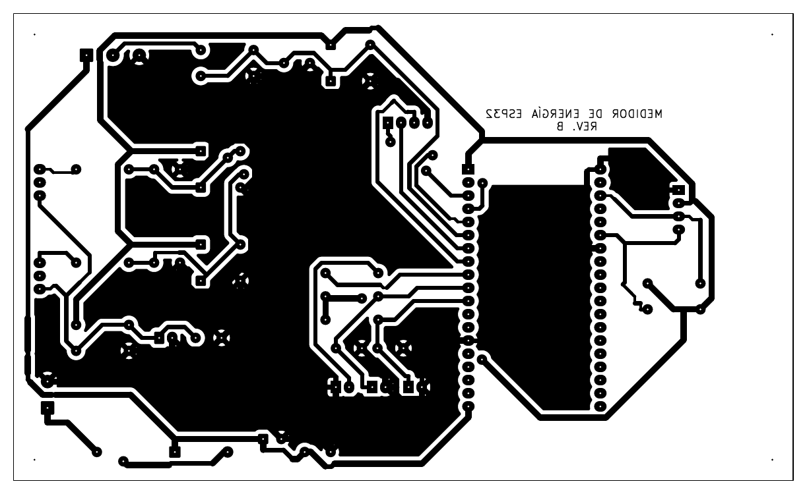

**Ilustración 3.** Cara de cobre a escala 1:1, como se imprime para la transferencia de tóner
(el texto se lee al revés). Fuente: elaboración propia en KiCad 10.

**Tabla 6.** Puentes de alambre de la PCB (lado de componentes). Coordenadas en mm desde la
esquina superior izquierda, vista desde los componentes.

| Puente | Red | Desde | Hasta | Largo |
|---|---|---|---|---|
| JP1 | CH1_ADC | (41,2; 27,8) junto a D2 | (79,4; 30,3) junto al ESP32 | 38 mm |
| JP2 | CH2_ADC | (44,3; 31,0) junto a D3 | (90,2; 32,7) pin 2 del ESP32 | 46 mm |
| JP3 | +3V3 | (67,0; 54,9) junto a R12 | (90,1; 66,7) bajo el ESP32 | 26 mm |
| JP4 | RES_IO34 | (72,5; 24,7) junto a J7 | (80,6; 27,3) junto a J7 | 9 mm |

Fuente: elaboración propia a partir de [`hardware/fabricacion/PUENTES.md`](hardware/fabricacion/PUENTES.md).

Los archivos de fabricación se exportan con
[`herramientas/exportar_fabricacion.sh`](herramientas/exportar_fabricacion.sh) en
[`hardware/fabricacion/`](hardware/fabricacion/) (Tabla 7).

**Tabla 7.** Archivos de fabricación de la PCB.

| Archivo | Uso |
|---|---|
| `toner/1-cobre-B_Cu-1a1.pdf` | Cobre para imprimir en láser **al 100 %**, sin ajustar a la página |
| `toner/2-serigrafia-F_SilkS-espejo-1a1.pdf` | Serigrafía opcional del lado de componentes (ya va en espejo) |
| `guia-montaje.pdf` | Dónde va cada componente y cada puente, visto desde arriba |
| `vista-cobre-desde-abajo.pdf` | El cobre como se ve al soldar |
| `cnc/gerbers-medidor.zip` | Gerber y taladros Excellon para fresado CNC o para un fabricante |
| `PUENTES.md` | Lista de puentes con su red, largo y agujeros |

Fuente: elaboración propia.

**Procedimiento de fabricación y montaje.**

1. Imprimir el cobre a escala 1:1 en impresora láser sobre papel de transferencia (o couché) y
   comprobar con regla que la placa mida 150 × 90 mm.
2. Lijar y desengrasar la baquelita, transferir con plancha caliente unos 5 min y retirar el papel en
   agua. Retocar con marcador permanente las pistas cortadas.
3. Atacar en percloruro férrico, retirar el tóner con acetona y revisar con lupa que no queden puentes de
   cobre entre pistas.
4. Perforar con brocas de 0,8, 1,0 y 1,3 mm según el archivo de taladros (1,3 mm para las borneras) y
   de 3,2 mm para los agujeros M3.
5. Soldar primero los **puentes de alambre** (JP2 y JP3 quedan bajo el ESP32), después los componentes
   de menor a mayor altura y al final los zócalos del ESP32.
6. Antes de energizar, seguir la verificación de la sección 7.9.

**Conexiones que salen de la placa.**

- **_Jacks_ de panel J2 y J3:** la resistencia de carga (R1 o R2) se suelda directamente entre los
  terminales de punta (T) y manga (S) de cada *jack* y se cubre con termoencogible. Desde el *jack* sale un
  par trenzado hacia los pads T y S de J2 o J3 en el borde izquierdo de la PCB. El anillo (R) del *jack*
  no se conecta; su pad solo sujeta el hilo.
- **J1:** bornera que recibe los 5 V del *jack* de alimentación de panel.
- **J5:** bornera del cable de tres hilos del módulo ZMPT101B, que atraviesa el tabique por un collarín.
- **J6:** cable de 4 hilos a la pantalla OLED, montada en la tapa.
- **D8, SW1 y SW2:** espadines con cables de dos hilos al LED y a los pulsadores de la tapa.

#### 7.7.2. Alternativa: placa perforada

Si la PCB no se pudiera fabricar a tiempo, el mismo circuito está distribuido y verificado sobre una
placa perforada de 9 × 15 cm, con 59 columnas por 35 filas de agujeros. Las coordenadas se dan como
(columna, fila), con la columna 0 a la izquierda y la fila 0 arriba, vistas desde la cara de
componentes. El ESP32 se monta sobre dos tiras de espadín hembra en las columnas 36 y 46 (10 pasos =
25,4 mm), con el conector USB hacia el borde inferior.

**Antes de soldar los zócalos (en la PCB o en la placa perforada) hay que medir con calibrador la
separación entre filas de la tarjeta comprada:** algunos clones de 38 pines no tienen exactamente 25,4 mm.

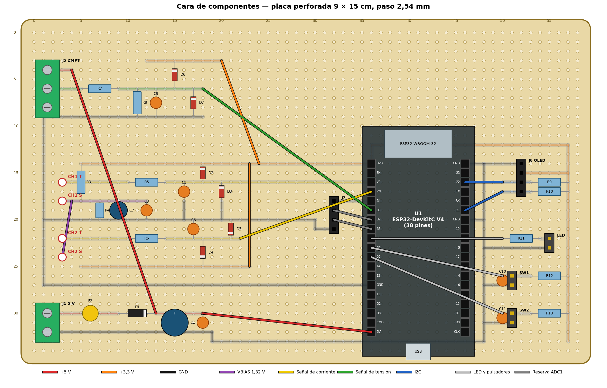

**Ilustración 4.** Placa perforada, cara de componentes. Las líneas tenues son las pistas de estaño de
la cara inferior y las gruesas, los puentes de cable aislado por la cara superior. Los círculos rojos
marcan los puntos donde se sueldan los cables que vienen de los *jacks* de panel. Fuente: elaboración
propia en Python y Matplotlib.

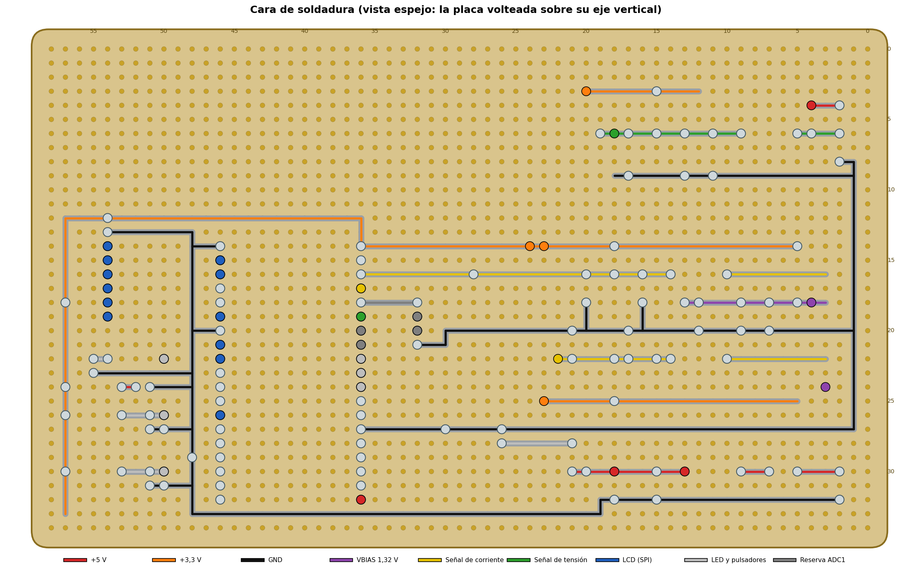

**Ilustración 5.** Placa perforada, cara de soldadura vista en espejo, como queda la placa al voltearla
para soldar. Fuente: elaboración propia en Python y Matplotlib.

**Verificación automática de la distribución.** La distribución está descrita agujero por agujero en
[`herramientas/placa_perforada.py`](herramientas/placa_perforada.py). Ese programa lee la netlist que
exporta KiCad y comprueba tres condiciones:

1. Cada red del esquemático forma un solo grupo conectado en la placa.
2. Dos redes distintas nunca comparten un agujero ni una pista.
3. Ninguna pista toca un pin marcado como "sin conexión".

El resultado actual es: *"Conectividad verificada: 21 redes del esquemático coinciden con la placa
perforada"*. (Las piezas que no van en la placa, R1 y R2 en los *jacks* del panel y U2, J4 y F1 en el
compartimento de red, están marcadas en el esquemático como fuera de la placa, de modo que sus redes
exclusivas no se cuentan.) Se comprobó además que el programa detecta errores introducidos a propósito: un
cortocircuito entre `CH1_ADC` y GND, un puente faltante en `V_ADC` y una pista sobre un pin sin
conexión.

**Tabla 8.** Puentes de cable aislado de la placa perforada (cara superior).

| # | Desde | Hasta | Color | Red |
|---:|---|---|---|---|
| 1 | (18, 30) C2 | (36, 32) pin 5V | Rojo | +5V |
| 2 | (13, 30) cátodo de D1 | (4, 4) J5-1 | Rojo | +5V al módulo ZMPT101B |
| 3 | (23, 14) bus de 3,3 V | (23, 25) bus de CH2 | Naranja | +3V3 |
| 4 | (24, 14) bus de 3,3 V | (20, 3) bus del canal de tensión | Naranja | +3V3 |
| 5 | (3, 24) punto CH2 S | (4, 18) bus VBIAS | Violeta | VBIAS |
| 6 | (22, 22) salida de CH2 | (36, 17) pin VN | Amarillo | CH2_ADC |
| 7 | (18, 6) salida del canal de tensión | (36, 19) pin 35 | Verde | V_ADC |
| 8 | (32, 19) J7-2 | (36, 20) pin 32 | Gris | RES_IO32 |
| 9 | (32, 20) J7-3 | (36, 21) pin 33 | Gris | RES_IO33 |
| 10 | (46, 16) pin 22 | (50, 16) | Azul | I2C_SCL |
| 11 | (46, 19) pin 21 | (50, 17) | Azul | I2C_SDA |
| 12 | (36, 22) pin 25 | (50, 22) R11 | Blanco | LED_EST |
| 13 | (36, 23) pin 26 | (50, 26) | Blanco | SW1 |
| 14 | (36, 24) pin 27 | (50, 30) | Blanco | SW2 |

Fuente: elaboración propia.

En la placa perforada, los cables de los *jacks* llegan a los puntos CH1 T (3, 16), CH1 S (3, 18),
CH2 T (3, 22) y CH2 S (3, 24).

### 7.8. Gabinete

El gabinete está diseñado en ABS, con dimensiones de 200 × 150 × 75 mm y paredes de 2,5 mm (Ilustración 6). Un tabique de 3 mm
lo divide en dos compartimentos:

- **Compartimento de red (posterior, unos 40 mm de fondo):** prensaestopas PG7 para el cable de red,
  regleta J4, portafusible F1 y módulo ZMPT101B sobre separadores. El cable de tres hilos hacia J5 pasa
  por un collarín en el tabique, de modo que la distancia de fuga entre zonas supera los 8 mm.
- **Compartimento de MBT (frontal):** PCB sobre cuatro separadores M3 de 10 mm, *jacks* de las
  pinzas y *jack* de alimentación en la pared izquierda, y ventana para el USB en la pared frontal.
- **Tapa:** ventana de 26,5 × 15 mm para la pantalla OLED, que queda rehundida 1,5 mm para protegerla
  de golpes, LED de estado, dos pulsadores y el rótulo de advertencia sobre la zona de red.

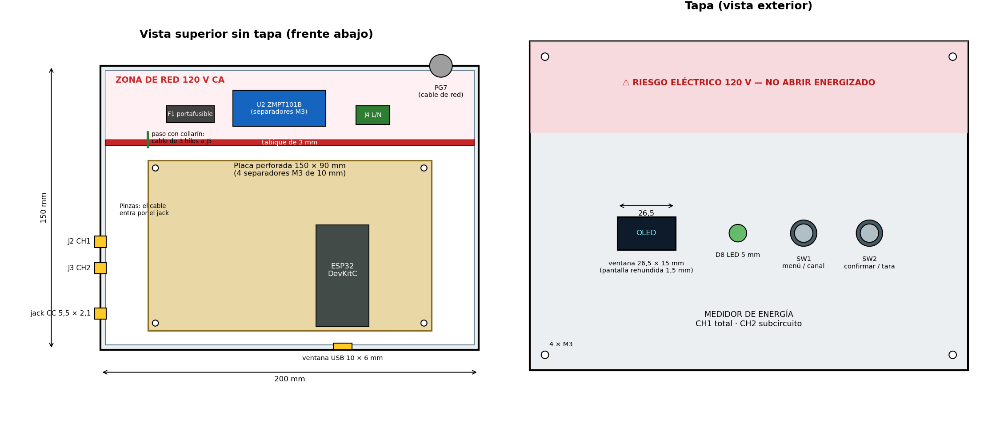

**Ilustración 6.** Planos del gabinete: vista superior sin tapa y vista exterior de la tapa, con cotas
en milímetros. Fuente: elaboración propia en Python y Matplotlib.

### 7.9. Procedimiento de montaje y verificación antes de energizar

1. Soldar primero las pistas de estaño, luego los componentes de menor a mayor altura y por último los
   espadines del ESP32. **No insertar el ESP32 todavía.**
2. Con el multímetro en continuidad, recorrer la Tabla 8 y la Ilustración 5 punto por punto. Comprobar
   que **no hay continuidad** entre +5V, +3V3, VBIAS y GND.
3. Alimentar J1 desde una fuente de laboratorio de 5 V **con límite de 200 mA** y sin el ESP32. Verificar
   que el consumo es casi nulo y que llega tensión al pin 5V del zócalo.
4. Insertar el ESP32 alimentado solo por USB, sin red. Medir 3,3 V en el bus naranja y
   **VBIAS = 1,32 V ± 0,03 V**.
5. Con el módulo ZMPT101B **desconectado de la red**, medir 1,35 V en GPIO35.
6. **Verificación de aislamiento**, firmada por dos integrantes: con un megóhmetro a 500 V CC entre los
   bornes de red (L y N unidos) y el GND de MBT, la resistencia debe ser de 1 MΩ o más. Revisar que el
   fusible F1 esté colocado y que el tabique no tenga cables que lo crucen fuera del collarín.
7. Energizar la red con el gabinete cerrado. Con el osciloscopio, comprobar una sinusoide de unos
   0,35 V pico centrada en 1,35 V en GPIO35, y ajustar el potenciómetro del módulo si hace falta.
8. Instalar una pinza sobre el conductor de fase de una carga resistiva conocida (por ejemplo, un
   calentador de 1.000 W) y comprobar la sinusoide en GPIO36.

**Regla de seguridad:** nunca desenchufar una pinza mientras abraza un conductor con carga, nunca abrir
el gabinete con la red conectada y nunca colocar la pinza alrededor de fase y neutro juntos (la medida
sería cero).

### 7.10. Prueba de resistencia (*HardExplosion*)

**Tabla 9.** Protocolo de la prueba de resistencia y resultados.

| # | Ensayo | Procedimiento | Criterio de aprobación | Resultado |
|---:|---|---|---|---|
| 1 | Caída libre | Desde 1 m sobre piso duro, por la cara frontal, un canto y una esquina | Enciende, la pantalla responde, ninguna pieza queda suelta | Pendiente |
| 2 | Vibración y sacudida | Agitar el gabinete cerrado durante 1 min en los tres ejes | Sin reinicios del ESP32 ni falsos contactos | Pendiente |
| 3 | Tirón de cables | Tirar con 20 N del cable de red y de cada cable de pinza | El prensaestopas y los *jacks* no ceden y ningún hilo se suelta | Pendiente |
| 4 | Polaridad invertida | Conectar los 5 V invertidos en el *jack* de alimentación | El equipo no enciende y no sufre daño (D1 bloquea) | Pendiente |
| 5 | Cortocircuito en 5 V | Cortocircuitar +5V a GND con fuente de 2 A | F2 se abre y se rearma al retirar la falla | Pendiente |
| 6 | Sobrecorriente en pinza | Pasar por la pinza de CH2 más de 34 A (o varias vueltas de conductor) | La señal recorta en los BAT85 y el ESP32 sigue funcionando | Pendiente |
| 7 | Operación continua | 2 h energizado con carga | Temperatura interna menor de 45 °C y sin reinicios | Pendiente |

Fuente: elaboración propia. La columna de resultados se completará el día de la prueba.

### 7.11. Banco de medición con tomacorriente de entrada y salida

Una pinza solo mide si abraza **un** conductor: si se coloca sobre el cable de un electrodoméstico, que
lleva fase y neutro juntos, las dos corrientes son iguales y opuestas y la lectura es cero. Para medir
equipos compatibles con el rango del banco sin cortar ni pelar su cable, se diseñó un banco con una
clavija para el tomacorriente de pared, un cable, un tramo de fase accesible para la pinza y un
tomacorriente para conectar el equipo.

#### 7.11.1. Funcionamiento

El esquemático del banco (Ilustración 7) está en
[`hardware/banco-pruebas.kicad_sch`](hardware/banco-pruebas.kicad_sch) (PDF en
[`hardware/banco-pruebas.pdf`](hardware/banco-pruebas.pdf)) y su ERC termina con **0 errores y 0
advertencias** ([`hardware/erc-banco.rpt`](hardware/erc-banco.rpt)).

1. **P1**, clavija NEMA 5-15P con cable de 3 hilos 14 AWG, se enchufa a un tomacorriente de pared.
2. Dentro de la caja, el **neutro** y la **tierra** van directo al tomacorriente X1.
3. La **fase** sale de la caja por un prensaestopas PG7, forma un **lazo de medición** exterior de unos
   16 cm de THHN 14 AWG aislado y vuelve a entrar por otro PG7 hasta el tornillo de bronce de X1.
4. La pinza **CT1** se cierra sobre una de las dos patas del lazo, de modo que la fase atraviesa su
   ventana **una sola vez**. Su cable va a J2 (CH1) del medidor.
5. El equipo a medir se enchufa en **X1**, un tomacorriente doble polarizado.

El medidor se alimenta de otro tomacorriente de pared, de modo que su propio consumo no se suma a la
medida. La tensión de la red es la misma en los dos tomacorrientes si están en el mismo circuito.

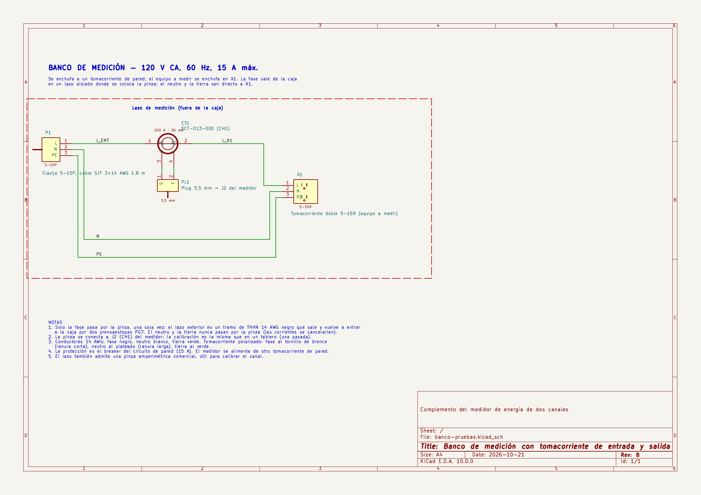

**Ilustración 7.** Esquemático del banco de medición (hoja A4): clavija, lazo de medición con la pinza y
tomacorriente de salida. Fuente: elaboración propia en KiCad 10.

#### 7.11.2. Rango y calibre

La fase atraviesa la pinza una sola vez, igual que cuando la pinza se instala en un tablero; por eso la
constante de calibración es la misma en los dos usos. La corriente queda limitada por el *breaker* del
circuito de pared (15 A), muy por debajo del límite lineal de CH1 (72,6 A, sección 7.4.1), así que ninguna
carga que el banco permita satura el canal. La resolución es la de la sección 7.4.1: un código del ADC
equivale a 73 mA (8,8 W a 120 V), y el promedio sobre miles de muestras baja el ruido por debajo de ese
valor. Para cargas muy pequeñas, la pinza puede ir en CH2 (J3), que tiene el doble de sensibilidad.

Todo el cableado es de cobre 14 AWG, el calibre que corresponde a un circuito de 15 A [8]. Un conductor
THHN 14 AWG mide unos 2,9 mm por fuera y la ventana de la SCT-013-000 tiene 13 mm, de modo que la pinza
cierra sin forzar el núcleo. El lazo también admite una pinza amperimétrica comercial, útil para
calibrar el canal contra una referencia.

#### 7.11.3. Gabinete y cableado

El diseño del banco utiliza una caja plástica de 130 × 90 × 65 mm (Ilustración 8). El tomacorriente va en la tapa, el
cable de red entra por un prensaestopas PG11 con alivio de tracción y el lazo sale y vuelve por dos PG7,
que también lo sujetan para que no se pueda halar hacia los bornes.

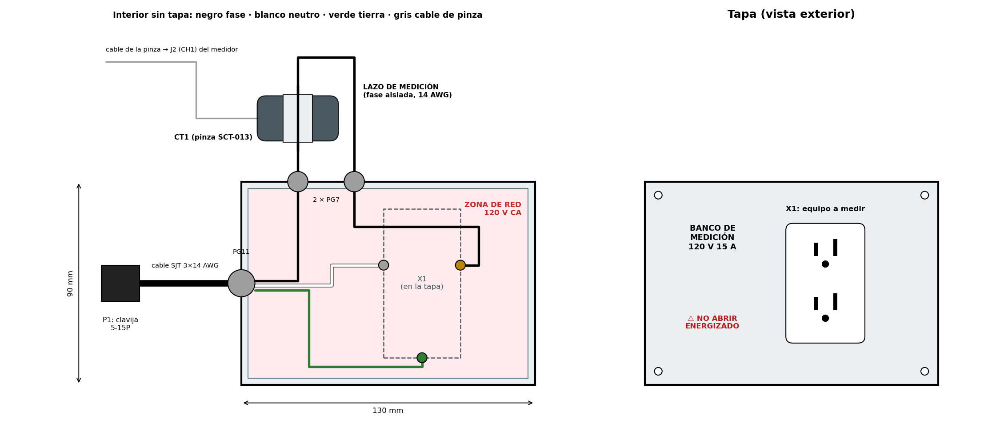

**Ilustración 8.** Banco de medición: interior sin tapa con el lazo de medición y la pinza (izquierda) y
tapa vista desde afuera (derecha). Fuente: elaboración propia en Python y Matplotlib.

**Tabla 10.** Materiales del banco de medición.

| # | Referencia | Descripción | Cant. |
|---:|---|---|---:|
| 1 | P1 | Clavija NEMA 5-15P con cable SJT 3 × 14 AWG de 1,8 m (puede ser una extensión cortada) | 1 |
| 2 | X1 | Tomacorriente doble polarizado con polo a tierra, 15 A 125 V (NEMA 5-15R) | 1 |
| 3 | CT1 | La misma pinza SCT-013-000 del medidor (no se compra adicional) | — |
| 4 | — | Caja plástica de 130 × 90 × 65 mm | 1 |
| 5 | — | Prensaestopas PG11 (cable de red) y PG7 (lazo de medición) | 1 + 2 |
| 6 | — | Cable THHN 14 AWG negro para el lazo | 0,3 m |
| 7 | — | Terminales de ojo y tubo termoencogible | 1 juego |

Fuente: elaboración propia.

**Tabla 11.** Lista de conductores del banco (todos de 14 AWG).

| # | Desde | Hasta | Color | Red |
|---:|---|---|---|---|
| 1 | P1, neutro | X1, tornillo plateado | Blanco | `N` |
| 2 | P1, tierra | X1, tornillo verde | Verde | `PE` |
| 3 | P1, fase | Primer PG7 (sale de la caja) | Negro | `L_ENT` |
| 4 | Lazo exterior, por la ventana de CT1 | Segundo PG7 (vuelve a la caja) | Negro | `L_ENT` → `L_X1` |
| 5 | Segundo PG7 | X1, tornillo de bronce | Negro | `L_X1` |

Fuente: elaboración propia. Las filas 3 a 5 son un solo tramo de cable, sin empalmes. En el tomacorriente
polarizado la fase va a la ranura corta (tornillo de bronce) y el neutro a la ranura larga (tornillo
plateado).

#### 7.11.4. Verificación antes de usar el banco

1. Sin conectar a la red, medir con el multímetro la continuidad de cada fila de la Tabla 11 y comprobar
   que no hay continuidad entre fase, neutro y tierra.
2. Comprobar a la vista que la pinza abraza **solo** una pata del lazo y que cierra por completo.
3. Conectar el conector macho de la pinza a J2 del medidor **antes** de enchufar el banco (nunca dejar el
   secundario abierto con carga).
4. Enchufar el banco y verificar X1 con un probador de tomacorrientes (fase, neutro y tierra correctos).
5. Conectar una carga resistiva conocida (bombillo incandescente o hervidor) en X1 y comparar la
   corriente con una pinza amperimétrica colocada en la otra pata del lazo, o con el PZEM-004T. Con esa
   medida se ajusta la constante de calibración del canal.

### 7.12. Simulación del circuito

Antes de soldar, las entradas analógicas y la alimentación se simularon en **ngspice** con el script
[`herramientas/simulacion.py`](herramientas/simulacion.py). Cada caso genera una netlist (carpeta
[`simulacion/`](simulacion/), donde se puede abrir y repetir a mano), la ejecuta y compara el resultado
con el criterio de diseño. Los modelos son los mismos supuestos de la sección 7.4:

- La pinza es una fuente de corriente ideal de relación 2000:1. No se modelan la saturación del núcleo
  ni su error de fase propio, que se miden en la calibración.
- El módulo ZMPT101B se modela por su salida: 2,5 V de reposo más una senoide.
- Los diodos BAT85 y 1N5819 usan parámetros ajustados a los puntos de sus hojas de datos.
- La entrada del ADC es una resistencia de 10 MΩ; su condensador de muestreo no se modela.

**Tabla 12.** Casos simulados y resultados.

| # | Caso | Resultado de la simulación | Criterio | Estado |
|---:|---|---|---|---|
| 1 | CH1, 60 A eficaces (nominal) | 0,392 V a 2,246 V | dentro de 0,15–2,45 V | Cumple |
| 2 | CH1, 72,6 A eficaces (límite) | 0,197 V a 2,441 V | máximo ≤ 2,45 V + 0,01 | Cumple |
| 3 | CH2, 30 A eficaces (nominal) | 0,329 V a 2,309 V | dentro de 0,15–2,45 V | Cumple |
| 4 | CH2, 34 A eficaces (límite) | 0,197 V a 2,441 V | máximo ≤ 2,45 V + 0,01 | Cumple |
| 5 | CH1, sobrecorriente de 150 A | -0,273 V a 3,543 V | entre −0,3 V y 3,6 V (máximo absoluto) | Cumple |
| 6 | CH1, sobrecorriente de 200 A | -0,295 V a 3,586 V | entre −0,3 V y 3,6 V (máximo absoluto) | Cumple |
| 7 | CH2, sobrecorriente de 80 A | -0,284 V a 3,569 V | entre −0,3 V y 3,6 V (máximo absoluto) | Cumple |
| 8 | CH2, sobrecorriente de 100 A | -0,299 V a 3,592 V | entre −0,3 V y 3,6 V (máximo absoluto) | Cumple |
| 9 | CH2, 20 A con 60 % de tercer armónico | 0,555 V a 2,083 V | dentro de 0,15–2,45 V | Cumple |
| 10 | VBIAS en reposo | 1,3194 V | 1,32 V ± 1 % | Cumple |
| 11 | CH1, ganancia a 60 Hz | 21,962 V/A en el secundario (10,98 mV por A de primario) | 22 Ω (sin pérdida en el filtro) | Cumple |
| 12 | CH1, atenuación en el armónico 50 (3 kHz) | -9,84 dB | atenuación conocida: el *firmware* la compensa | Informativo |
| 13 | CH1, atenuación en la frecuencia de Nyquist (4 kHz) | -12,13 dB | filtro de primer orden: lo que pase de 4 kHz se pliega atenuado | Informativo |
| 14 | Frecuencia de corte, CH1 y tensión | 1025 Hz y 990 Hz | ≈ 1 kHz (τ ≈ 156–161 µs) | Cumple |
| 15 | Desfase a 60 Hz entre corriente y tensión | CH1 -3,37°, CH2 -3,39°, V -3,47° → diferencia máx. 0,10° | ≤ 0,2° (error en P ≤ 0,3 % con FP = 0,5) | Cumple |
| 16 | Tensión, salida del módulo 2,5 V ± 1 V | 0,813 V a 1,894 V | dentro de 0,15–2,45 V | Cumple |
| 17 | Tensión, salida del módulo 2,5 V ± 1,4 V | 0,597 V a 2,110 V | dentro de 0,15–2,45 V | Cumple |
| 18 | Entrada del regulador con adaptador de 4,75 V y 500 mA | 4,306 V | ≥ 4,4 V (3,3 V regulados) · ≥ 4,1 V (ESP32 aún funciona a 3,0 V) | **No cumple** |
| 19 | Entrada del regulador con adaptador de 5 V y 500 mA | 4,556 V | ≥ 4,4 V (3,3 V regulados) · ≥ 4,1 V (ESP32 aún funciona a 3,0 V) | Cumple |
| 20 | Entrada del regulador con adaptador de 5,25 V y 500 mA | 4,806 V | ≥ 4,4 V (3,3 V regulados) · ≥ 4,1 V (ESP32 aún funciona a 3,0 V) | Cumple |

Fuente: elaboración propia con ngspice.

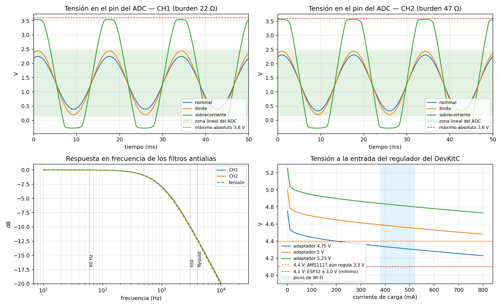

**Ilustración 9.** Simulación en ngspice: tensión en el pin del ADC de CH1 y CH2 en corriente
nominal, en el límite lineal y con sobrecorriente (arriba); respuesta en frecuencia de los tres filtros
y tensión a la entrada del regulador según la corriente de carga (abajo). Fuente: elaboración propia con
ngspice y Matplotlib.

**Cambios de diseño a partir de la simulación:**

1. **Protección de las entradas.** Con el primer valor del filtro (1,5 kΩ y 100 nF), el pin pasaba el
   máximo absoluto de 3,6 V con 80 A en CH2 (3,59 V y −0,30 V) y con 200 A en CH1 (3,61 V). Se cambió a
   **3,3 kΩ y 47 nF**, que conserva la constante de tiempo y reduce a menos de la mitad la corriente por
   los diodos; con eso todos los casos de sobrecorriente quedan dentro del límite (filas 5 a 8).
2. **Canal de tensión.** Para que su constante de tiempo siguiera igualando la de los canales de
   corriente, el divisor pasó de 10 kΩ/12 kΩ a **11 kΩ/13 kΩ**. El desfase relativo bajó de 0,16° a 0,10°
   (fila 15).
3. **Adaptador.** Con un adaptador en el mínimo de la norma USB (4,75 V), el regulador del DevKitC deja de
   entregar 3,3 V durante las ráfagas de Wi-Fi (fila 18). Se especifica un adaptador de 5,1 V.

**Limitaciones del diseño observadas en la simulación:**

- El filtro de primer orden atenúa 9,8 dB el armónico 50 (fila 12). Como la respuesta es conocida, el
  *firmware* la compensa al calcular la distorsión armónica.
- En la frecuencia de Nyquist (4 kHz) el filtro solo atenúa 12 dB (fila 13): las componentes por encima
  de 4 kHz se pliegan atenuadas. En cargas domésticas su amplitud es pequeña, pero un filtro de segundo
  orden sería mejor si se rediseña la entrada.

> **Validación física pendiente.** Ningún circuito se ha armado todavía. Los resultados de simulación
> corresponden a los modelos y supuestos utilizados. Falta verificar el funcionamiento físico mediante
> el procedimiento de la sección 7.9 y la calibración del banco (sección 7.11.4).

### 7.13. Modelos 3D

Los modelos 3D se hicieron con las mismas herramientas de diseño del proyecto: la placa en **KiCad 10** y
los gabinetes en **FreeCAD 1.1**. El modelo de la placa se exporta en STEP y se monta dentro del gabinete
en FreeCAD, de modo que los dos modelos comparten la misma geometría.

#### 7.13.1. Placa en KiCad

La PCB de la sección 7.7.1 lleva el modelo 3D de cada componente: las huellas son las de la biblioteca
oficial de KiCad con sus modelos STEP. El ESP32-DevKitC se modeló en FreeCAD
([`herramientas/modelo_devkitc.py`](herramientas/modelo_devkitc.py)) con su tarjeta, espadines,
conector micro-USB, pulsadores y regulador; el módulo ESP32-WROOM-32 y los dos zócalos 1 × 19 son los
modelos de la biblioteca de KiCad. Las vistas de las Ilustraciones 10 a 12 las genera
`kicad-cli` y sirven también como guía de montaje.

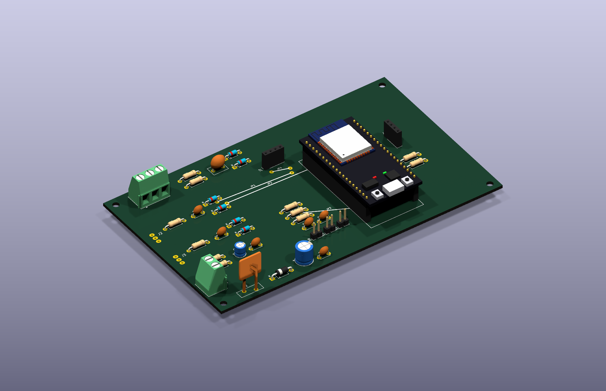

**Ilustración 10.** Modelo 3D de la PCB: ESP32-DevKitC sobre sus zócalos, canales de corriente y de
tensión, alimentación y conectores. Las líneas blancas son los puentes de alambre. Fuente: elaboración
propia en KiCad 10 y FreeCAD.

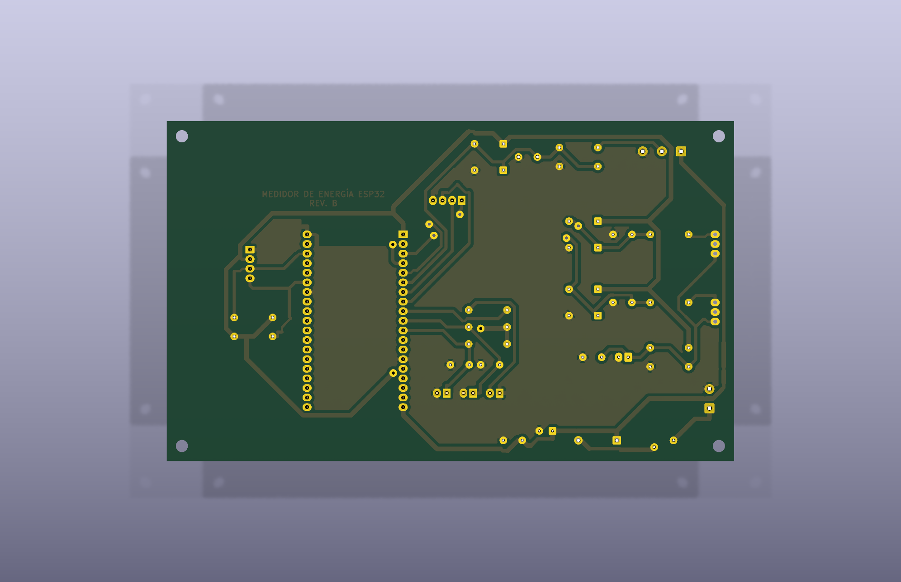

**Ilustración 11.** Cara de cobre de la PCB con el relleno de GND. Fuente: elaboración propia en
KiCad 10.

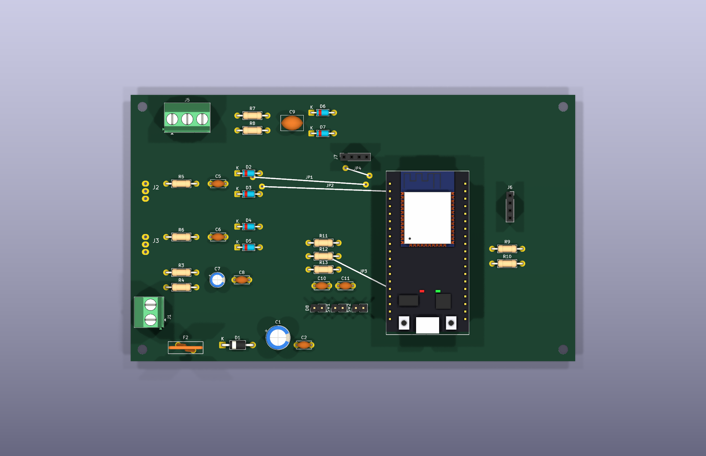

**Ilustración 12.** Vista superior del modelo 3D, que sirve de guía de montaje junto con la
Tabla 6. Fuente: elaboración propia en KiCad 10.

El modelo completo de la placa con sus componentes se exportó en STEP
([`hardware/3d/medidor-placa.step`](hardware/3d/medidor-placa.step)) para montarlo dentro del gabinete
en FreeCAD.

#### 7.13.2. Gabinetes y ensambles en FreeCAD

Los dos equipos se modelaron en **FreeCAD 1.1** con scripts de Python que construyen cada pieza a
partir de sólidos, operaciones booleanas y redondeos (carpeta [`freecad/`](freecad/)). Cada cota es un
parámetro del script, de modo que un cambio de medida se propaga a la caja, a la tapa y al ensamble.
El ensamble del medidor en FreeCAD importa el STEP exportado desde KiCad (sección 7.13.1),
por lo que conserva la posición de cada componente del diseño de la PCB.

**Medidor.** La caja de 200 × 150 × 75 mm tiene paredes de 2,5 mm y el tabique de 3 mm que separa la
zona de red, con el módulo ZMPT101B, el portafusible F1, la bornera J4 y el prensaestopas PG7, de la
zona de muy baja tensión. Allí va la placa sobre separadores de 10 mm. Los *jacks* de las pinzas y el de
alimentación están en la pared izquierda, y la ventana del USB en la pared frontal (Ilustraciones
13 a 15). La tapa lleva la ventana rehundida de la OLED, el LED, los pulsadores y los rótulos
grabados.

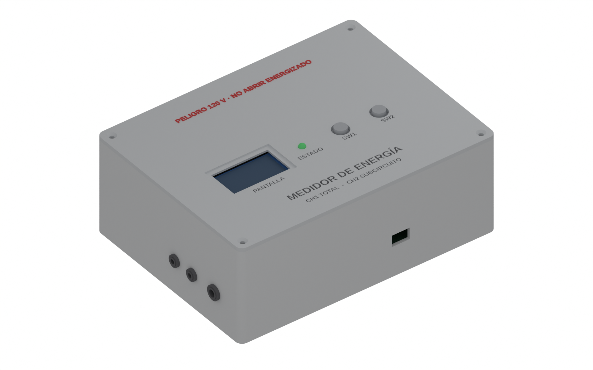

**Ilustración 13.** Modelo 3D del medidor cerrado. Fuente: elaboración propia en FreeCAD (vista en Blender).

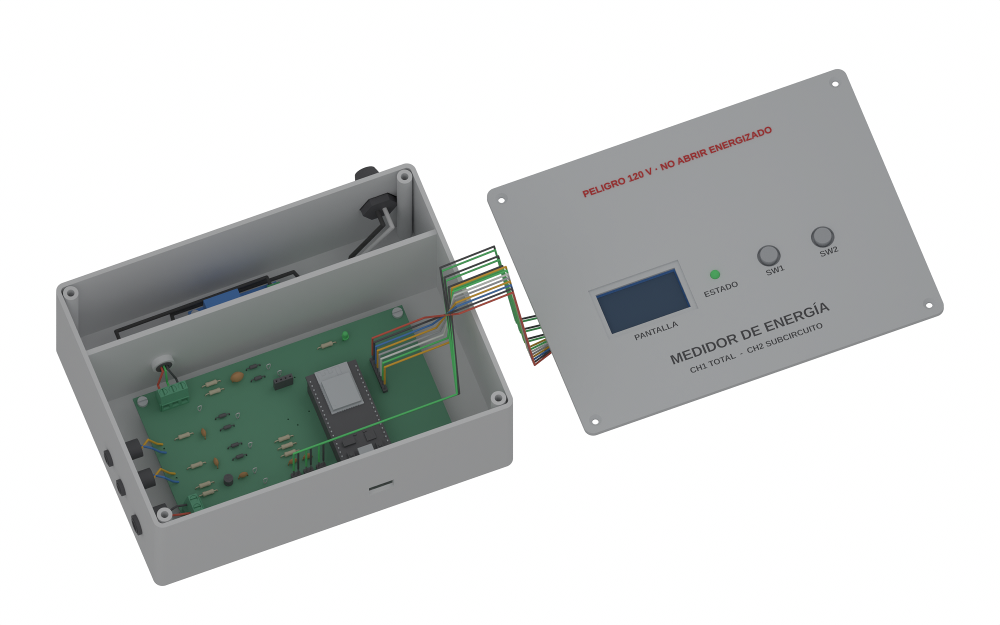

**Ilustración 14.** Modelo 3D del medidor con la tapa a un lado. Se muestran la PCB exportada desde
KiCad con el ESP32, la zona de red tras el tabique y los componentes de la tapa. Fuente: elaboración propia en FreeCAD y KiCad
(vista en Blender).

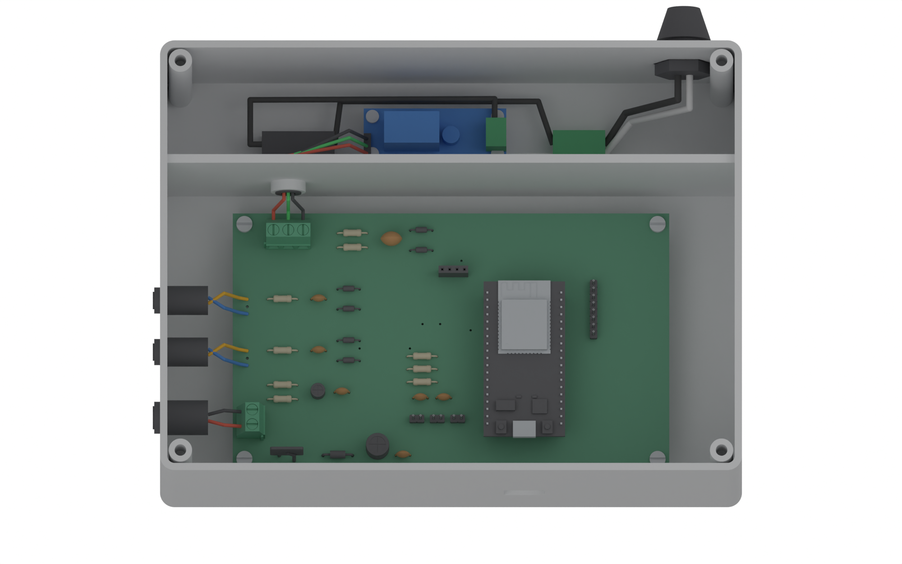

**Ilustración 15.** Vista superior del medidor sin tapa: compartimento de red (arriba), paso del
cable de tres hilos por el collarín y PCB (abajo). Fuente: elaboración propia en FreeCAD y
KiCad (vista en Blender).

**Banco de medición.** El diseño permite medir equipos compatibles con su rango sin cortar su cable.
Incluye una clavija NEMA 5-15P que se enchufa a la pared, el cordón SJT 3 × 14 AWG, que entra por un prensaestopas
PG11, y un tomacorriente doble (X1) donde se conecta el equipo, en una caja de 130 × 90 × 65 mm. El
neutro y la tierra van directo del cordón a los tornillos plateado y verde de X1. La fase, en cambio,
sale de la caja por un prensaestopas PG7, forma un lazo exterior de conductor THHN 14 AWG aislado, con
dos patas paralelas separadas 25 mm, y vuelve a entrar por un segundo PG7 hasta el tornillo de bronce de
X1. La pinza SCT-013-000 se cierra sobre **una sola pata** del lazo, de modo que mide la corriente del
equipo conectado sin abrir ningún circuito, y su cable termina en el conector macho de 3,5 mm que va a J2 del
medidor (Ilustraciones 16 a 18). En el modelo, X1 queda a lo largo de la caja porque su yugo de 107 mm
no cabe a lo ancho.

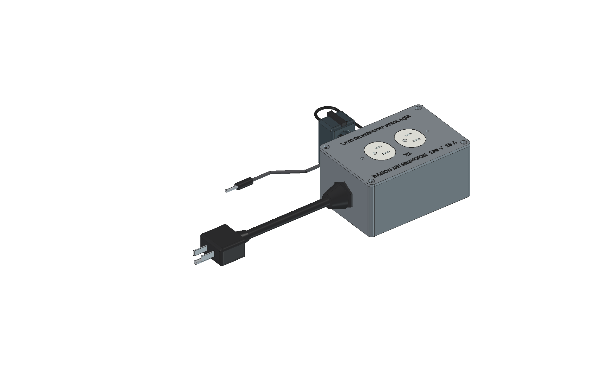

**Ilustración 16.** Modelo 3D del banco de medición cerrado: clavija y cordón al frente, tomacorriente X1
en la tapa y, detrás, el lazo de fase con la pinza. Fuente: elaboración propia en FreeCAD.

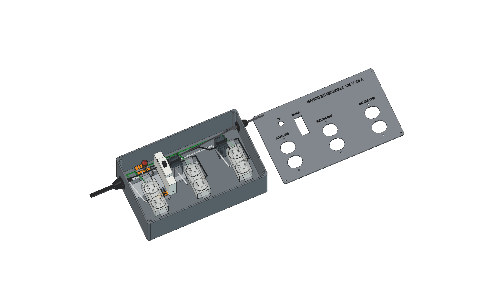

**Ilustración 17.** Banco con la tapa a un lado. El tomacorriente y la pinza se dibujan translúcidos para
mostrar el cableado: neutro (blanco) y tierra (verde) directo a X1, y la fase (negro) que sale al lazo
exterior, atraviesa la ventana de la pinza y vuelve al tornillo de bronce. Fuente: elaboración propia en
FreeCAD.

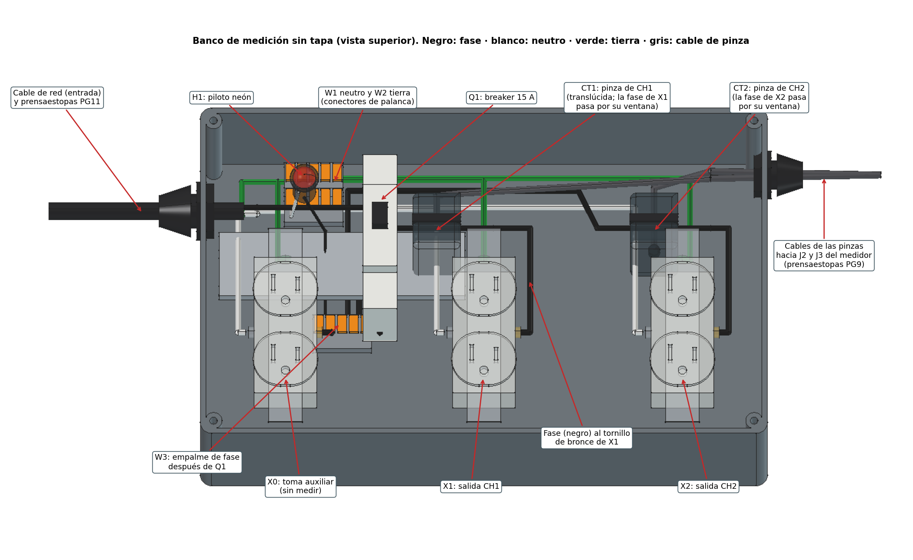

**Ilustración 18.** Vista superior del banco sin tapa, con cada pieza rotulada. Fuente: elaboración propia
en FreeCAD (rótulos con Matplotlib).

Los ensambles se exportaron en STEP con colores (`freecad/medidor.step` y `freecad/banco.step`), y
los cuerpos y tapas, en STL para impresión 3D ([`freecad/stl/`](freecad/stl/)). Para regenerar los
modelos y las ilustraciones:

```bash
cd C2-ABPR/freecad
./generar.sh
```

### 7.14. Interfaz de usuario

El sistema tiene dos interfaces: la pantalla OLED del gabinete, para leer el medidor en el sitio, y una
plataforma web, para el histórico, el pronóstico y las alertas. Las dos usan el mismo registro de 40 B del
contrato ADR-001 que el ESP32 produce una vez por segundo.

#### 7.14.1. Plataforma web (TanStack Start)

La plataforma ([`plataforma/`](plataforma/)) es una aplicación de **TanStack Start** (React 19 y
TypeScript, con rutas por archivo de TanStack Router) que reúne el *frontend* y el *backend* en un solo
proceso de Node. El ESP32 envía cada segundo un registro ADR-001 de 40 B a `POST /api/ingesta`, y después
de una caída de Wi-Fi envía en un solo cuerpo los registros que guardó. El servidor los valida, los guarda
en una base de datos Postgres alojada en Supabase y calcula todo lo que muestra el tablero (Tabla 13).
El esquema está en [`plataforma/supabase/migrations/`](plataforma/supabase/migrations/); cada lote se
guarda en una transacción y los registros repetidos se descartan.

**Tabla 13.** Funciones del servidor de la plataforma.

| Función | Cómo se calcula |
|---|---|
| Energía | Cada registro aporta $P \cdot \Delta t$ a la hora que le corresponde; las brechas de más de 60 s (nodo sin red) no se integran |
| Umbral de alerta | Percentil 95 de la potencia de cada canal en los últimos 21 días, recalculado cada 7 días |
| Alertas | Potencia sobre el umbral durante 5 min o más; estados notificada, revisada y descartada |
| Pronóstico | El LSTM de la sección 7.15 corre en el servidor en TypeScript con los pesos exportados de PyTorch (diferencia menor que 1e-4); 48 h recursivas desde las últimas 24 horas completas, con intervalo del 90 % |
| Proyección del mes | Energía medida más el promedio de los últimos 7 días completos por los días que faltan |
| Tiempo real | *Server-Sent Events* (`/api/eventos`): el tablero recibe cada registro apenas llega |

Fuente: elaboración propia.

**Tabla 14.** Formato del registro ADR-001 (40 B, *little-endian*, sin relleno), común al *firmware* y a la plataforma.

| Byte | Tipo | Campo | Escala |
|---:|---|---|---|
| 0 | `uint32` | Tiempo Unix (UTC) | 1 s |
| 4 | `int16` | Tensión eficaz | 0,01 V |
| 6 | `int16` × 3 | Corriente eficaz de CH1, CH2 y CH3 (reserva) | 0,01 A |
| 12 | `int16` × 3 | Potencia activa | 1 W |
| 18 | `int16` × 3 | Potencia reactiva | 1 var |
| 24 | `int16` × 3 | Potencia aparente | 1 VA |
| 30 | `int16` × 3 | Factor de potencia | 0,0001 |
| 36 | `int16` | Frecuencia | 0,01 Hz |
| 38 | `int16` | Distorsión armónica total de la corriente de CH1 | 0,01 % |

Fuente: elaboración propia.

El tablero (Ilustración 19) muestra la potencia actual, la energía del día, el factor de potencia y
la tensión; la potencia de las últimas 24 h de CH1 y CH2 con el pronóstico de las 24 h siguientes y el
umbral de alerta; el desglose CH1, CH2 y resto; la energía del mes por día con su proyección y costo
aproximado; y la tabla de alertas, donde cada alerta se marca como revisada o descartada. En el teléfono
pasa a una sola columna con una barra inferior de secciones (Ilustración 20) y tiene tema claro y
oscuro.

Mientras el medidor no esté montado, los datos los genera el simulador (`pnpm simular`), que genera datos de
consumo simulado de una vivienda de la costa Caribe y envía **las mismas tramas binarias** que enviará el
*firmware*, con las mismas cabeceras. El tablero muestra un aviso mientras los datos provengan del
simulador. Las pruebas automáticas (`pnpm test`, 10 pruebas) verifican la decodificación de la trama, la
equivalencia del LSTM con PyTorch, la integración de energía, el umbral P95, las alertas y el pronóstico.
Además, se enviaron al servidor tramas codificadas con el mismo código del *firmware*
(`firmware/test/trama_prueba.cpp`) y se decodificaron sin diferencias.

> La temperatura de entrada del pronóstico es un perfil diario típico de Barranquilla (25–32 °C), fuera
> del rango con el que se entrenó el modelo (Sceaux, Francia), y su intervalo usa el error medido con
> los datos de UCI; por eso el pronóstico se presenta como ilustrativo hasta reentrenar con las
> mediciones propias.


**Ilustración 19.** Tablero de la plataforma en vista de escritorio, alimentado por el simulador del
nodo. Fuente: elaboración propia en TanStack Start.

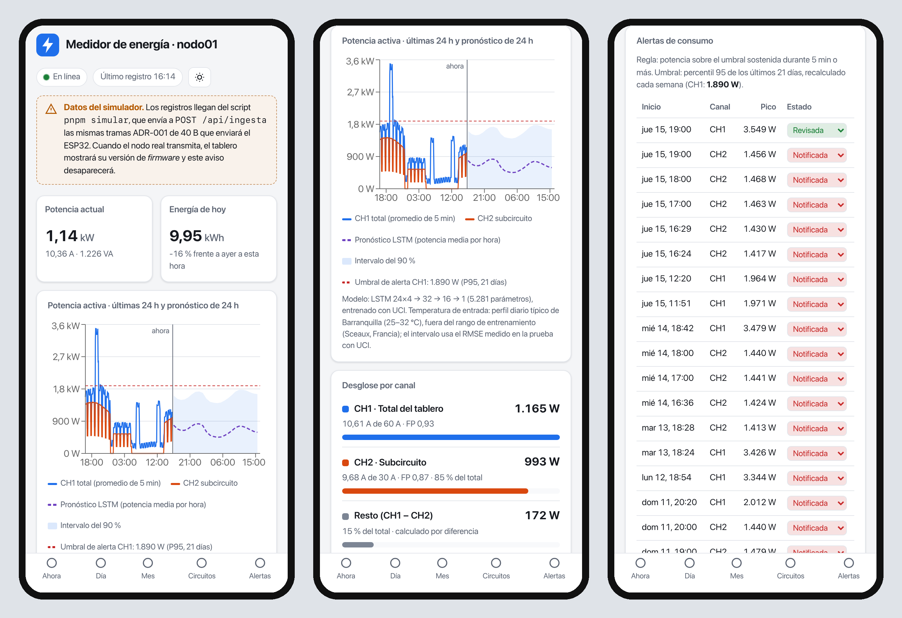

**Ilustración 20.** Tablero en un teléfono de 390 px de ancho: inicio, potencia de 24 h con
pronóstico y alertas. Fuente: elaboración propia en TanStack Start.

#### 7.14.2. Pantalla OLED y pulsadores

La OLED SSD1306 de 128 × 64 píxeles tiene cuatro pantallas en ciclo y dos que aparecen según el evento
(Ilustración 21). Se dibujaron píxel por píxel con la misma fuente de 5 × 7 que usará el *firmware*,
que no tiene tildes. La Tabla 15 resume la función de los pulsadores y del LED, y la Ilustración
22 muestra la navegación.

**Tabla 15.** Función de los pulsadores y del LED de estado.

| Elemento | Acción | Resultado |
|---|---|---|
| SW1 | Pulsación corta | Pasa a la siguiente pantalla: Resumen → CH1 → CH2 → Energía y red |
| SW2 | Sostenido 2 s en CH1 o CH2 | Abre la tara del canal (cero de corriente sin carga) |
| SW2 | Sostenido 2 s en la tara | Guarda el nuevo cero (SW1 cancela) |
| SW2 | Pulsación en la pantalla de alerta | Reconoce la alerta y vuelve al resumen |
| SW1 o SW2 | Con la pantalla apagada | Enciende la pantalla (se apaga tras 60 s sin pulsar) |
| LED D8 | Fijo | Registros entregados a la plataforma en los últimos 15 s |
| LED D8 | Parpadeo a 1 Hz | Sin red: los registros se guardan en la memoria flash (LittleFS) |
| LED D8 | Parpadeo a 5 Hz | Alerta sin reconocer |

Fuente: elaboración propia.

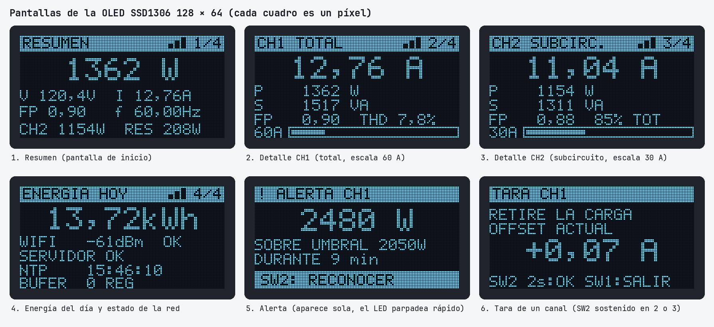

**Ilustración 21.** Las seis pantallas de la OLED a tamaño de píxel. Fuente: elaboración propia en
Python.

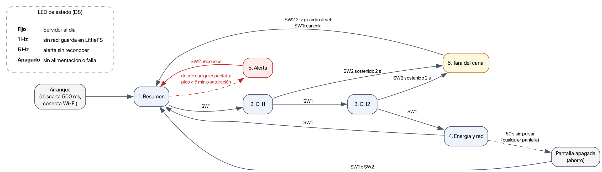

**Ilustración 22.** Navegación entre pantallas con SW1 y SW2, y estados del LED. Fuente: elaboración
propia en Graphviz.

### 7.15. Modelo inicial de pronóstico (LSTM)

Como todavía no hay registros propios del medidor, la red se entrenó con datos públicos del conjunto
*Individual Household Electric Power Consumption* de la UCI (una vivienda en Sceaux, Francia, medida cada
minuto entre diciembre de 2006 y noviembre de 2010), agregada a consumo horario en kWh. La temperatura
horaria del mismo lugar se tomó del archivo histórico de Open-Meteo. Las horas con menos de 30 minutos
medidos se interpolan solo para dar continuidad a la serie; ninguna ventana que las contenga se usa para
entrenar ni para evaluar.

La arquitectura es la del primer entregable: ventana de entrada de 24 h × 4 variables (consumo, hora del
día, día de la semana y temperatura) → LSTM de 32 unidades → *dropout* de 0,2 → capa densa de 16 (ReLU) →
capa densa de 1, con **5.281 parámetros**. La capa LSTM se programó con un solo vector de sesgo por
compuerta, como en las ecuaciones del primer entregable, porque la implementación estándar de PyTorch usa
dos.

Los datos se dividieron en periodos consecutivos: entrenamiento hasta el 30 de junio de 2009 (21.940
ventanas), validación hasta el 31 de diciembre de 2009 (4.377) y prueba de enero a noviembre de 2010
(7.528). La normalización se calcula solo con los datos de entrenamiento. El entrenamiento usa Adam con
parada temprana sobre la validación y tarda unos 6 s en CPU (Ilustración 23).

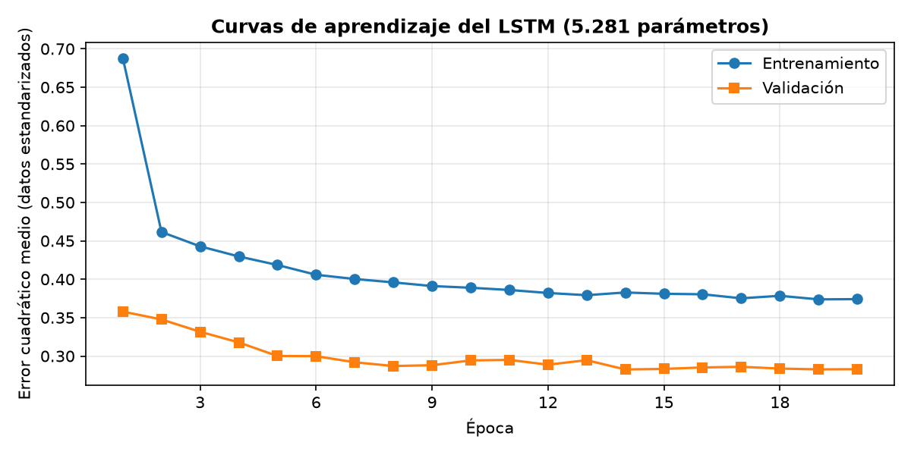

**Ilustración 23.** Error cuadrático medio por época en entrenamiento y validación. El error de
validación queda por debajo del de entrenamiento porque el *dropout* solo actúa al entrenar y porque el
segundo semestre de 2009 es más regular. Fuente: elaboración propia en Python con PyTorch.

El modelo se comparó con tres líneas base ingenuas: persistencia (repetir la última hora medida),
ingenuo diario (repetir el último día) e ingenuo semanal (misma hora de la semana anterior). A 24 h y 48 h
el LSTM pronostica de forma recursiva desde cada medianoche del periodo de prueba (Tabla 16).

**Tabla 16.** Error del pronóstico en el conjunto de prueba (2010), en kWh por hora.

| Horizonte | Modelo | MAE | RMSE | MAPE |
|---|---|---:|---:|---:|
| 1 h | LSTM | 0,350 | 0,505 | 43,8 % |
| 1 h | Persistencia | 0,411 | 0,622 | 45,4 % |
| 1 h | Ingenuo diario | 0,558 | 0,823 | 68,3 % |
| 1 h | Ingenuo semanal | 0,586 | 0,842 | 76,5 % |
| 24 h | LSTM | 0,464 | 0,649 | 65,8 % |
| 24 h | Persistencia | 0,706 | 0,971 | 86,5 % |
| 24 h | Ingenuo diario | 0,558 | 0,824 | 69,5 % |
| 24 h | Ingenuo semanal | 0,579 | 0,835 | 76,0 % |
| 48 h | LSTM | 0,480 | 0,665 | 70,3 % |
| 48 h | Persistencia | 0,722 | 0,986 | 90,2 % |
| 48 h | Ingenuo diario | 0,566 | 0,832 | 70,8 % |
| 48 h | Ingenuo semanal | 0,580 | 0,837 | 76,2 % |

Fuente: elaboración propia. A 24 h se evaluaron 286 pronósticos y a 48 h, 281.

El LSTM reduce el MAE frente a la mejor línea base en un 15 % a 1 h, un 17 % a 24 h y un 15 % a 48 h. En
MAPE a 48 h presenta un valor similar al del ingenuo diario (70,3 % frente a 70,8 %). El MAPE aumenta
en las horas nocturnas de bajo consumo, por lo que la comparación se centra en el MAE y el RMSE. La Ilustración
24 muestra un caso del conjunto de prueba.

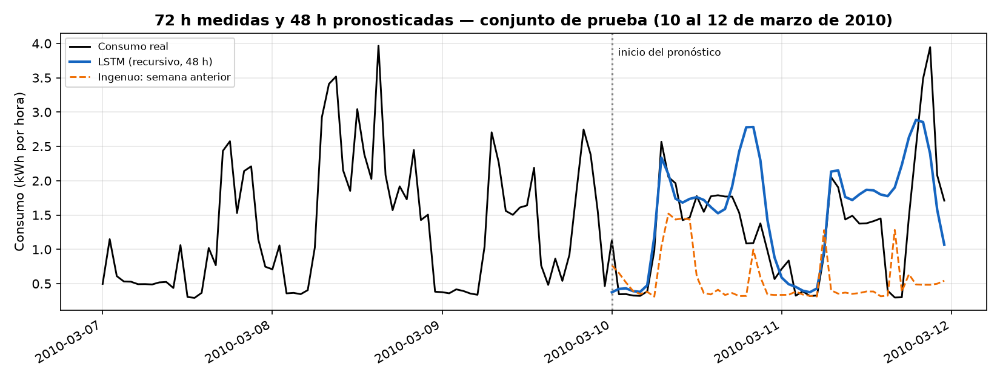

**Ilustración 24.** Consumo medido durante 72 h y pronóstico recursivo de las 48 h siguientes, del 10
al 12 de marzo de 2010, frente a la línea base semanal. Fuente: elaboración propia en Python con PyTorch.

**Limitaciones.** A 24 h y 48 h la red recibe la temperatura observada de las horas futuras, lo que
equivale a suponer un pronóstico meteorológico perfecto. Los datos de la UCI corresponden a otra vivienda. Estos resultados permiten evaluar el proceso de
entrenamiento, pero no describen el desempeño del modelo con las mediciones propias, aún pendientes.
El estudio completo del corte 3 (SARIMA y *gradient boosting*, validación por pliegues y prueba de
Diebold–Mariano) se hará con las mediciones propias.

Los archivos están en [`pronostico/`](pronostico/): `modelo.py` (datos y red), `train.py`
(entrenamiento, evaluación y gráficas), `predict.py` (pronóstico de 48 h a partir de un CSV con
columnas `tiempo,kwh,temp`) y los pesos entrenados `lstm.pt`.

### 7.16. *Firmware*

El *firmware* ([`firmware/`](firmware/)) está escrito en C++ con PlatformIO y el *framework* Arduino para
ESP32 (ESP-IDF 4.4). Compila sin errores y ocupa el 30 % de la RAM y el 74 % de la memoria de programa.
Se reparte en tres tareas de FreeRTOS (Tabla 17).

**Tabla 17.** Tareas del *firmware*.

| Núcleo | Tarea | Función |
|---|---|---|
| 1 | Adquisición | Muestrea V, CH1 y CH2 a 8.000 muestras/s por canal con el ADC1 y cierra una ventana de 60 ciclos de red (≈ 1 s). Entrega los resultados por una cola; falta verificar la estabilidad del muestreo con Wi-Fi activo |
| 0 | Red | Wi-Fi, hora por NTP, un registro ADR-001 por ventana, búfer de 1.200 registros (20 min sin red) y envío en lotes cada 5 s |
| 0 | Interfaz | Pantallas de la OLED, pulsadores SW1 y SW2, LED de estado y alerta local |

Fuente: elaboración propia.

El cálculo está en una biblioteca sin dependencias de Arduino (`lib/medicion/`):

- La ventana empieza y termina en cruces por cero de la tensión, de modo que siempre contiene ciclos
  enteros.
- Los valores eficaces y la potencia activa se obtienen de sumas enteras exactas, quitando la media de
  la propia ventana; por eso no hace falta conocer el valor exacto de VBIAS.
- Como el ADC convierte V, I1 e I2 en secuencia, la tensión se interpola al instante de cada corriente.
  El retardo de conversión se mide al arrancar.
- $S = V I$, $Q = \sqrt{S^2 - P^2}$ y $FP = P/S$; la frecuencia sale de los ciclos sobre la duración real
  de la ventana.
- El THD de la corriente de CH1 se calcula con el algoritmo de Goertzel hasta el armónico 40,
  compensando la atenuación del filtro antialias (sección 7.12).
- La tara mide el piso de ruido de un canal sin carga, lo guarda en la memoria no volátil y lo resta en
  cuadratura.

La biblioteca se probó en el PC con señales sintéticas que reproducen la cadena del *hardware* (pinza,
resistencia de carga, VBIAS, ADC de 12 bits con ruido de 0,7 códigos y retardo de multiplexado de 12 µs y
24 µs). La Tabla 18 resume los resultados (`make -C firmware/test`).

**Tabla 18.** Prueba del cálculo con señales sintéticas.

| Caso | Magnitud | Esperado | Medido |
|---|---|---:|---:|
| Carga resistiva, 60 Hz | V eficaz | 120,00 V | 120,01 V |
| | I eficaz CH1 | 10,000 A | 10,000 A |
| | P CH1 | 1.200,0 W | 1.199,9 W |
| | THD CH1 | 0 % | 0,05 % |
| Motor con FP 0,8 y 30 % de tercer armónico | I eficaz CH1 | 20,881 A | 20,880 A |
| | P CH1 | 1.929,6 W | 1.929,0 W |
| | THD CH1 | 30,0 % | 29,96 % |
| Red a 59,8 Hz con carga de 1 A | Frecuencia | 59,800 Hz | 59,798 Hz |
| | P CH1 | 112,10 W | 112,17 W |
| Sin compensar el multiplexado, FP 0,5 | Error en P CH1 | — | 0,77 % |

Fuente: elaboración propia. El último caso muestra por qué hace falta la interpolación: sin ella, el
retardo de 12 µs produce un error de 0,77 % en la potencia con FP = 0,5.

> **Pruebas pendientes en el ESP32:** la estabilidad del ritmo de muestreo con Wi-Fi activo, la
> linealidad del ADC del ejemplar y las constantes de calibración, que se ajustan en el banco de medición
> (sección 7.11.4).

## 8. Verificación de la metodología y del cronograma

### 8.1. Metodología

El proyecto sigue la metodología de aprendizaje basado en proyectos de la asignatura, en tres fases
alineadas con los cortes:

1. **Diseño (corte 1):** definición del problema, requerimientos, arquitectura y materiales. *Cumplida.*
2. **Implementación del _hardware_ (corte 2):** esquemático, distribución en placa, compra, montaje,
   gabinete y pruebas. *Diseño terminado; montaje y pruebas físicas pendientes.*
3. **_Firmware_, comunicación y validación (corte 3):** adquisición, cálculo de magnitudes, envío a la
   plataforma, tablero y comparación contra una referencia. *Adelantada: el* firmware *y la plataforma ya están
   escritos y probados con señales sintéticas y con el simulador; falta probarlos con el* hardware.

El diseño se revisó mediante las siguientes verificaciones y cálculos:

- ERC de KiCad sobre los esquemáticos del medidor y del banco de medición.
- DRC de KiCad de la PCB con comparación contra el esquemático, y comparación automática entre la
  netlist y la distribución de la placa perforada alternativa.
- Cálculos de excursión, filtro y potencia documentados en la sección 7.4.
- Simulación en ngspice de las entradas analógicas y la alimentación (sección 7.12), que obligó a
  cambiar el filtro de entrada, el divisor de tensión y el adaptador.

### 8.2. Cronograma

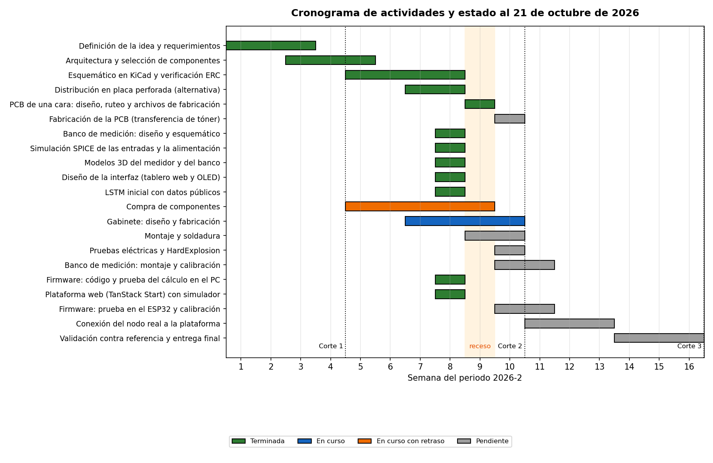

**Ilustración 25.** Cronograma de actividades y estado al 21 de octubre de 2026. Fuente: elaboración
propia en Python y Matplotlib.

**Tabla 19.** Estado de las actividades.

| Actividad | Semanas | Estado |
|---|---|---|
| Definición de la idea y requerimientos | 1–3 | Terminada |
| Arquitectura y selección de componentes | 3–5 | Terminada |
| Esquemático en KiCad y verificación ERC | 5–8 | Terminada |
| Distribución en placa perforada (alternativa) | 7–8 | Terminada |
| PCB de una cara: diseño, ruteo y archivos de fabricación | 9 | Terminada |
| Fabricación de la PCB (transferencia de tóner) | 10 | Pendiente |
| Banco de medición: diseño y esquemático | 8 | Terminada |
| Simulación SPICE de las entradas y la alimentación | 8 | Terminada |
| Modelos 3D del medidor y del banco | 8 | Terminada |
| Diseño de la interfaz (tablero web y OLED) | 8 | Terminada |
| LSTM inicial con datos públicos | 8 | Terminada |
| Compra de componentes | 5–9 | En curso, con retraso |
| Gabinete: diseño y fabricación | 7–10 | En curso |
| Montaje y soldadura | 9–10 | Pendiente |
| Pruebas eléctricas y *HardExplosion* | 10 | Pendiente |
| Banco de medición: montaje y calibración | 10–11 | Pendiente |
| *Firmware*: código y prueba del cálculo en el PC | 8 | Terminada |
| Plataforma web (TanStack Start) con simulador | 8 | Terminada |
| *Firmware*: prueba en el ESP32 y calibración | 10–11 | Pendiente |
| Conexión del nodo real a la plataforma | 11–13 | Pendiente |
| Validación y entrega final | 14–16 | Pendiente |

Fuente: elaboración propia.

### 8.3. Dificultades encontradas

1. **Retraso en las compras.** Las compras estaban previstas para la semana 5 y se iniciaron tarde. Los
   pedidos importados tienen fechas de entrega cercanas a la semana de entrega del corte. Se priorizó
   el comercio local de Barranquilla para los componentes pasivos.
2. **ADC externo equivocado.** Se llegaron a cotizar dos módulos ADS1015, que muestrean a 3.300
   muestras/s como máximo, un orden de magnitud por debajo de las 24.000 muestras/s que requieren tres
   canales a 8.000 muestras/s. Se descartaron y se mantiene el ADC1 interno del ESP32.
3. **Componentes no disponibles en el país.** El amplificador MCP6004, el diodo doble BAT54S (de montaje
   superficial) y las resistencias de 0,1 % no se consiguen localmente. Se rediseñó la entrada sin
   amplificador separador (sección 7.4.3), con diodos BAT85 de inserción y resistencias de 1 % con
   calibración por *software*.
4. **Rango lineal del ADC.** Al revisar la documentación de Espressif se encontró que el diseño anterior
   (reposo de 1,65 V y picos de 1,15 V) salía de la zona lineal del ADC. Se recalcularon la
   polarización y las resistencias de carga (sección 7.4.1).
5. **PCB fabricada frente a placa perforada.** El primer diseño contemplaba una PCB de dos capas con una
   ranura fresada de aislamiento, que no era viable en el tiempo disponible. Primero se sacó por
   completo la red de la placa (el módulo ZMPT101B queda en un compartimento separado) y se distribuyó
   el circuito en placa perforada. Como la entrega exige una PCB fabricada, después se diseñó una PCB
   de **una sola cara**, que se puede hacer en el laboratorio con transferencia de tóner. Para que
   cupiera en una cara sin vías, el ruteo automático usa la cara de componentes como capa de puentes:
   quedaron 4 puentes de alambre. La placa perforada queda como alternativa.
6. **Pantalla.** Se compraron pantallas TFT de 4", pero el diseño del gabinete y el consumo favorecen la
   OLED SSD1306 de 0,96" por I2C, que usa solo dos pines. La TFT queda como alternativa.
7. **Errores encontrados en simulación.** La simulación en ngspice mostró que el filtro de entrada
   original permitía superar la tensión máxima absoluta del pin ante sobrecorrientes grandes y que un adaptador de
   4,75 V no alcanza para el regulador durante las ráfagas de Wi-Fi. Se corrigieron antes de comprar los
   componentes (sección 7.12).
8. **Medición de equipos sueltos.** Una pinza no mide sobre el cable de un electrodoméstico, porque abraza
   fase y neutro a la vez. Se diseñó el banco de medición de la sección 7.11: una clavija, un cable, un lazo
   exterior con la fase separada para colocar la pinza y un tomacorriente. Una primera versión tenía
   *breaker*, piloto, tres tomacorrientes y dos pinzas; se simplificó porque el circuito de pared ya trae
   su protección y para medir un equipo basta una pinza.
9. **Sin datos propios para el pronóstico.** Como aún no hay registros del medidor, el LSTM se entrenó con una
   serie pública (sección 7.15); el modelo definitivo se entrenará con las mediciones del corte 3.

## 9. Referencias

[1] XM S.A. E.S.P., *Reporte integral de sostenibilidad, operación y mercado 2024*, Colombia, 2025.
Disponible en: https://www.xm.com.co/reporte-integral-de-sostenibilidad-operacion-y-mercado-2024

[2] YHDC, *Product Specification: Current Transformer, Model SCT013-000*, Beijing YaoHuaDeChang
Electronic Co., 2015. Disponible en:
https://statics3.seeedstudio.com/assets/file/bazaar/product/101990029-SCT-013-000-Datasheet.pdf

[3] Qingxian Zeming Langxi Electronic Devices, *ZMPT101B: Current-Type Voltage Transformer*, hoja de
datos, 2018.

[4] Espressif Systems, *ESP32 Series Datasheet*, versión 5.3, 2026. Disponible en:
https://www.espressif.com/sites/default/files/documentation/esp32_datasheet_en.pdf

[5] Espressif Systems, *ESP-IDF Programming Guide: Analog to Digital Converter (ADC)*, ESP32, 2026.
Disponible en: https://docs.espressif.com/projects/esp-idf/en/stable/esp32/api-reference/peripherals/adc/adc_oneshot.html

[6] IEEE, *IEEE Std 1459-2010: Standard Definitions for the Measurement of Electric Power Quantities
Under Sinusoidal, Nonsinusoidal, Balanced, or Unbalanced Conditions*, 2010.
DOI: 10.1109/IEEESTD.2010.5439063

[7] G. W. Hart, "Nonintrusive appliance load monitoring", *Proceedings of the IEEE*, vol. 80, n.º 12,
pp. 1870-1891, 1992. DOI: 10.1109/5.192069

[8] Ministerio de Minas y Energía de Colombia, *Resolución 9 0708 de 2013: Reglamento Técnico de
Instalaciones Eléctricas (RETIE)*, Bogotá, 2013.

[9] H. Nyquist, "Certain topics in telegraph transmission theory", *Transactions of the AIEE*, vol. 47,
n.º 2, pp. 617-644, 1928. DOI: 10.1109/T-AIEE.1928.5055024

[10] OpenEnergyMonitor, *CT Sensors — Interfacing with an Arduino*, documentación, 2023. Disponible en:
https://docs.openenergymonitor.org/electricity-monitoring/ct-sensors/interface-with-arduino.html

[11] Shelly Group, *Shelly EM*, documentación del producto. Disponible en: https://www.shelly.com

[12] Emporia Energy, *Emporia Vue Energy Monitor*, documentación del producto. Disponible en:
https://www.emporiaenergy.com

[13] Sense Labs, *Sense Energy Monitor*, documentación del producto. Disponible en: https://sense.com

[14] IoTaWatt Inc., *IoTaWatt open WiFi electric energy monitor*, documentación. Disponible en:
https://iotawatt.com

[15] Peacefair, *PZEM-004T V3.0 User Manual*, hoja de datos.

[16] Microchip Technology, *Atmel M90E32AS: Enhanced Poly-Phase High-Performance Wide-Span Energy
Metering IC*, hoja de datos, 2015.

## 10. Anexo: archivos fuente y cómo regenerar las ilustraciones

Todas las ilustraciones se elaboraron con *software* de diseño a partir de archivos fuente incluidos en
este repositorio:

```
C2-ABPR/
├── README.md                         este documento
├── hardware/
│   ├── medidor-energia.kicad_sch     esquemático (abrir con KiCad 9 o superior)
│   ├── medidor-energia.kicad_pro     proyecto de KiCad
│   ├── Medidor.kicad_sym             símbolos propios (ESP32, ZMPT101B, pinza, clavija, tomacorriente)
│   ├── sym-lib-table                 tabla de bibliotecas del proyecto
│   ├── medidor-energia.pdf           esquemático en PDF
│   ├── medidor-energia.net           netlist exportada por KiCad
│   ├── erc.rpt                       reporte de la verificación eléctrica
│   ├── banco-pruebas.kicad_sch       esquemático del banco de medición
│   ├── banco-pruebas.kicad_pro       proyecto de KiCad del banco
│   ├── banco-pruebas.pdf             esquemático del banco en PDF
│   ├── banco-pruebas.net             netlist del banco
│   ├── erc-banco.rpt                 ERC del banco
│   ├── medidor-energia.kicad_pcb     PCB de una cara (con modelos 3D)
│   ├── ruteo-freerouting.ses         ruteo elegido de Freerouting
│   ├── fabricacion/                  PDF para tóner, Gerber, taladros, guía de montaje y puentes
│   ├── Medidor.pretty/, fp-lib-table huellas propias (zócalo del DevKitC, cables de jack, puente)
│   ├── drc.rpt                       DRC con comparación contra el esquemático
│   └── 3d/                           modelo del DevKitC, huellas, posición de conectores y STEP
├── herramientas/
│   ├── generar_esquematico.py        genera el esquemático de KiCad
│   ├── generar_banco.py              genera el esquemático del banco de medición
│   ├── simulacion.py                 simulación en ngspice y tabla de resultados
│   ├── generar_pcb.py                PCB de una cara a partir de la netlist (Freerouting)
│   ├── exportar_fabricacion.sh       archivos de fabricación, vistas 3D, STEP y DRC
│   ├── modelo_devkitc.py             modelo 3D del ESP32-DevKitC (FreeCAD)
│   ├── placa_perforada.py            distribución alternativa en placa perforada y su verificación
│   ├── figuras.py                    diagrama de bloques, gabinetes y cronograma
│   └── sexpr.py                      lector y escritor del formato de KiCad
├── simulacion/                       netlists de ngspice, datos y resultados.md
├── plataforma/                       aplicación TanStack Start (frontend + backend), ver su README
├── firmware/                         firmware del ESP32 (PlatformIO), ver su README
├── interfaz/
│   └── oled.py                       pantallas de la OLED y diagrama de navegación
├── pronostico/
│   ├── modelo.py                     datos y red LSTM
│   ├── train.py                      entrenamiento, evaluación y gráficas
│   ├── predict.py                    pronóstico de 48 h
│   └── lstm.pt                       pesos entrenados
├── freecad/                          gabinetes y ensambles en FreeCAD, piezas en STEP y STL
└── img/                              ilustraciones del documento
```

Para regenerar todo (requiere KiCad 10, Freerouting 2.5 y Java solo para rutear de nuevo, FreeCAD 1.1, Blender,
ngspice, Python 3 con Matplotlib y Pillow, y Graphviz):

```bash
cd herramientas
python3 generar_esquematico.py
cd ../hardware
kicad-cli sch erc -o erc.rpt medidor-energia.kicad_sch
kicad-cli sch export netlist --format kicadsexpr -o medidor-energia.net medidor-energia.kicad_sch
kicad-cli sch export pdf -o medidor-energia.pdf medidor-energia.kicad_sch
pdftoppm -png -r 160 -singlefile medidor-energia.pdf ../img/esquematico
python3 ../herramientas/generar_banco.py
kicad-cli sch erc -o erc-banco.rpt banco-pruebas.kicad_sch
kicad-cli sch export netlist --format kicadsexpr -o banco-pruebas.net banco-pruebas.kicad_sch
kicad-cli sch export pdf -o banco-pruebas.pdf banco-pruebas.kicad_sch
pdftoppm -png -r 200 -singlefile banco-pruebas.pdf ../img/banco-esquematico
cd ../herramientas
python3 placa_perforada.py      # falla si la placa no coincide con la netlist
python3 figuras.py
python3 simulacion.py > ../simulacion/resultados.md
cd ../interfaz && python3 oled.py
cd ../plataforma && pnpm install && pnpm test && pnpm build && pnpm capturas
cd ../firmware && make -C test && pio run
cd ../herramientas && freecadcmd modelo_devkitc.py
python3 generar_pcb.py          # 'rutear' para rutear de nuevo (java + freerouting.jar)
./exportar_fabricacion.sh       # fabricación, vistas 3D, STEP y DRC
cd ../freecad && ./generar.sh
```

El LSTM se regenera con las instrucciones de [`pronostico/README.md`](pronostico/README.md) (requiere
PyTorch y descarga los datos públicos).
