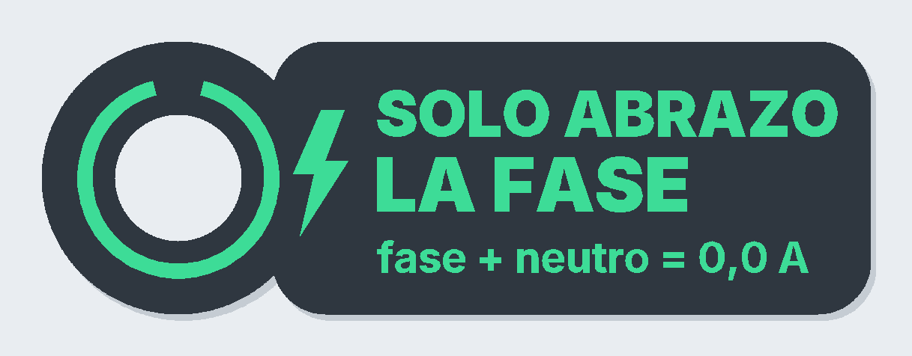

# Llavero de la pinza

Llavero de dos colores con forma de pinza **SCT-013**: la argolla pasa por el hueco de la pinza,
como el conductor de fase. Tres chistes del proyecto, misma forma:

| Archivo | Chiste |
|---|---|
| `llavero-fase` | **SOLO ABRAZO LA FASE** · fase + neutro = 0,0 A *(si la pinza abraza el cable completo de un equipo, fase y neutro se cancelan y mide cero)* |
| `llavero-hardexplosion` | **HARDEXPLOSION: PENDIENTE** *(la tabla de la prueba de resistencia, toda en "Pendiente")* |
| `llavero-revision` | **REVISIÓN E.9 · ESTA SÍ ES** la final (dijimos igual en la E.5) |



## Imprimir

- Medidas: 79 × 26 × 3,6 mm. Hueco de 12 mm para la argolla.
- Abrir `3mf/llavero-<chiste>.3mf` en Bambu Studio u OrcaSlicer: es **un objeto con dos partes**.
  La parte `base` va con el filamento 1 (gris oscuro o negro) y `color` con el filamento 2 (verde).
  Si el programa no las asigna solo, cambiar el filamento de la parte `color` en la lista de objetos.
- Sin 3MF: importar juntos `stl/llavero-<chiste>-base.stl` y `-color.stl` y responder **Sí** a
  "¿cargar como un solo objeto con varias partes?".
- Capa de 0,2 mm, boquilla de 0,4 mm, cara plana sobre la cama (el color queda arriba, al ras).
  El verde ocupa solo las 3 últimas capas, así que el cambio de filamento es corto.
- El texto pequeño mide 2,9 mm de alto; con el generador de perímetros Arachne (por defecto) sale bien.
- Sin AMS: pausar en la capa de 3,0 mm, cambiar a verde y continuar. Así todo lo que está a esa
  altura sale verde, que es justo el dibujo.

## Cambiar el chiste

Editar `CHISTES` en `generar_llavero.py` y ejecutar:

```sh
pip install trimesh shapely mapbox_earcut manifold3d fonttools pillow
python3 stand/llavero/generar_llavero.py
```
